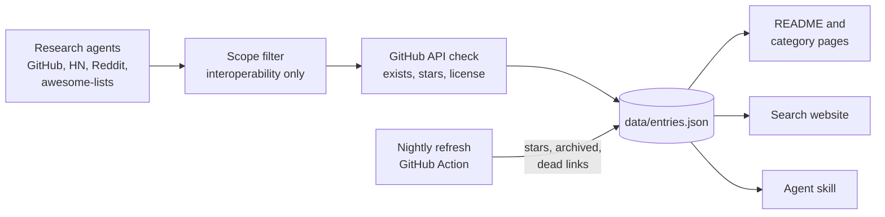

<div align="center">

<a href="https://alexgaoth.github.io/awesome-reverse-engineered/"></a>

<p><a href="README.md">English</a> · <a href="README.zh-CN.md">简体中文</a> · <a href="README.fr.md">Français</a> · <b>Español</b></p>

### 11,944 herramientas de código abierto que existen porque alguien hizo ingeniería inversa de un producto cerrado: una app, una API, un dispositivo, un protocolo, un formato de archivo, un juego o una herramienta de IA.

[](https://awesome.re) [](#qué-contiene) [](#qué-contiene) [](.github/workflows/refresh.yml) [](data/entries.json) [](LICENSE)

[](#dale-el-índice-completo-a-tu-agente-de-ia) [](#dale-el-índice-completo-a-tu-agente-de-ia) [](https://github.com/alexgaoth/awesome-reverse-engineered/stargazers)

**[Buscar en el índice](https://alexgaoth.github.io/awesome-reverse-engineered/)** · **[Skill para agentes](#dale-el-índice-completo-a-tu-agente-de-ia)** · **[Categorías](#qué-contiene)** · **[Populares esta semana](#populares-esta-semana)** · **[Proponer un proyecto](#contribuir)**

<sub>Los nombres y descripciones de los proyectos están en inglés.</sub>

</div>

---

## Dale el índice completo a tu agente de IA

Cuando una tarea necesita comunicarse con algo sin API oficial (un enchufe inteligente, un coche, una app de mensajería, un formato de archivo), tu agente busca en este índice, ordena por estrellas, actividad y licencia, lee el README y elige la herramienta adecuada.

```bash
npx skills add alexgaoth/awesome-reverse-engineered
```

<details><summary><b>Otras formas de instalarlo</b></summary>

**Plugin de Claude Code**

```
/plugin install reverse-engineered --marketplace alexgaoth/awesome-reverse-engineered
```

**Cualquier agente o terminal (un solo archivo, solo la biblioteca estándar de Python)**

```bash
curl -sL https://raw.githubusercontent.com/alexgaoth/awesome-reverse-engineered/main/plugin/skills/find-reverse-engineered/scripts/re_index.py -o re_index.py
python3 re_index.py search tuya local          # ranked matches
python3 re_index.py info make-all/tuya-local   # entry + README excerpt
python3 re_index.py clone make-all/tuya-local  # shallow clone into vendor/
```

</details>

<p align="center"></p>
<p align="center"><sub>Salida real del skill con los datos actuales.</sub></p>

## Búscalo en la web

Filtra 11,944 proyectos por categoría, lenguaje y estado de salud, ordenados por estrellas o actividad reciente. Cada búsqueda tiene un enlace para compartir.

<p align="center"><a href="https://alexgaoth.github.io/awesome-reverse-engineered/"></a></p>

<p align="center"><a href="https://alexgaoth.github.io/awesome-reverse-engineered/"><b>Abrir el buscador →</b></a></p>

## Qué contiene

**11,944 proyectos** que suman **10.3 M** de estrellas en GitHub: 6,680 activos, 1,808 en desaceleración, 2,202 inactivos, 806 archivados. Lenguajes principales: Python (3,028), C++ (1,776), C (1,625), JavaScript (730), TypeScript (667).

<p align="center"></p>

| Categoría | Proyectos | Destacados |
|---|--:|---|
| [**Herramientas de IA y clientes de LLM**](categories/ai-tools-llm-clients.md) | 726 | [claw-code](https://github.com/ultraworkers/claw-code), [system-prompts-and-models-of-ai-tools](https://github.com/x1xhlol/system-prompts-and-models-of-ai-tools), [system_prompts_leaks](https://github.com/asgeirtj/system_prompts_leaks) |
| [**Decompilaciones y reimplementaciones de juegos**](categories/game-decompilations-reimplementations.md) | 3,022 | [shadPS4](https://github.com/shadps4-emu/shadPS4), [v86](https://github.com/copy/v86), [RPCS3](https://github.com/RPCS3/rpcs3) |
| [**Dispositivos, IoT y hardware**](categories/devices-iot-hardware.md) | 2,538 | [KOReader](https://github.com/koreader/koreader), [LibrePods](https://github.com/librepods-org/librepods), [OpenLogi](https://github.com/AprilNEA/OpenLogi) |
| [**Clientes de API web y de apps no oficiales**](categories/unofficial-web-app-api-clients.md) | 807 | [yt-dlp](https://github.com/yt-dlp/yt-dlp), [youtube-dl](https://github.com/ytdl-org/youtube-dl), [MediaCrawler](https://github.com/NanmiCoder/MediaCrawler) |
| [**Mensajería y redes sociales**](categories/messaging-social-apps.md) | 278 | [WeChatMsg](https://github.com/LC044/WeChatMsg), [ItChat](https://github.com/littlecodersh/ItChat), [wechaty](https://github.com/wechaty/wechaty) |
| [**Clientes de terceros**](categories/third-party-clients.md) | 160 | [spotify-tui](https://github.com/Rigellute/spotify-tui), [nuclear](https://github.com/nukeop/nuclear), [SimpMusic](https://github.com/maxrave-dev/SimpMusic) |
| [**Plataformas chinas y asiáticas**](categories/chinese-asian-platforms.md) | 313 | [lx-music-desktop](https://github.com/lyswhut/lx-music-desktop), [alist](https://github.com/AlistGo/alist), [12306](https://github.com/testerSunshine/12306) |
| [**Ecosistema Apple**](categories/apple-ecosystem.md) | 336 | [fastlane](https://github.com/fastlane/fastlane), [homebridge](https://github.com/homebridge/homebridge), [OSX-KVM](https://github.com/kholia/OSX-KVM) |
| [**Drivers y hardware de bajo nivel**](categories/drivers-low-level-hardware.md) | 415 | [MonitorControl](https://github.com/MonitorControl/MonitorControl), [tinygrad](https://github.com/tinygrad/tinygrad), [G-Helper](https://github.com/seerge/g-helper) |
| [**Automoción**](categories/automotive.md) | 391 | [openpilot](https://github.com/commaai/openpilot), [evcc](https://github.com/evcc-io/evcc), [VESC firmware](https://github.com/vedderb/bldc) |
| [**Automatización industrial y de edificios**](categories/industrial-building-automation.md) | 268 | [HslCommunication](https://github.com/dathlin/HslCommunication), [plc4x](https://github.com/apache/plc4x), [IoTClient](https://github.com/zhaopeiym/IoTClient) |
| [**Firmware y sistemas embebidos**](categories/firmware-embedded.md) | 419 | [LEDE (Lean)](https://github.com/coolsnowwolf/lede), [OpenWrt](https://github.com/openwrt/openwrt), [Tasmota](https://github.com/arendst/Tasmota) |
| [**Protocolos de red y de comunicación**](categories/network-wire-protocols.md) | 415 | [Sunshine](https://github.com/LizardByte/Sunshine), [moonlight-qt](https://github.com/moonlight-stream/moonlight-qt), [Impacket](https://github.com/fortra/impacket) |
| [**Formatos de archivo**](categories/file-formats.md) | 425 | [FFmpeg](https://github.com/FFmpeg/FFmpeg), [ImHex](https://github.com/WerWolv/ImHex), [SheetJS](https://github.com/SheetJS/sheetjs) |
| [**Servicios en línea revividos**](categories/online-service-revivals.md) | 169 | [NoLongerEvil Thermostat](https://github.com/codykociemba/NoLongerEvil-Thermostat), [Legacy Update](https://github.com/LegacyUpdate/LegacyUpdate), [wire-pod](https://github.com/kercre123/wire-pod) |
| [**Reimplementaciones de software de escritorio**](categories/desktop-software-reimplementations.md) | 201 | [vaultwarden](https://github.com/dani-garcia/vaultwarden), [PhotoCraft](https://github.com/storytold/photocraft), [Proton](https://github.com/ValveSoftware/Proton) |
| [**Frontends alternativos**](categories/alternative-frontends.md) | 121 | [searxng](https://github.com/searxng/searxng), [searx](https://github.com/searx/searx), [Whoogle Search](https://github.com/benbusby/whoogle-search) |
| [**Apps móviles**](categories/mobile-apps.md) | 102 | [revanced-manager](https://github.com/ReVanced/revanced-manager), [Metrolist](https://github.com/MetrolistGroup/Metrolist), [LibreTube](https://github.com/libre-tube/LibreTube) |
| [**Herramientas de ingeniería inversa**](categories/re-tooling.md) | 737 | [rea](https://github.com/morluto/rea), [Ghidra](https://github.com/NationalSecurityAgency/ghidra), [jadx](https://github.com/skylot/jadx) |
| [**Colecciones y listas Awesome**](categories/collections-awesome-lists.md) | 101 | [awesome reverse-engineering (wtsxDev)](https://github.com/wtsxDev/reverse-engineering), [android-security-awesome](https://github.com/ashishb/android-security-awesome), [mendel5/alternative-front-ends](https://github.com/mendel5/alternative-front-ends) |

## Populares esta semana

Los proyectos con más estrellas que recibieron commits en los últimos 7 días.

| Proyecto | Qué hace | ★ | Salud | Lenguaje |
|---|---|--:|:-:|---|
| [yt-dlp](https://github.com/yt-dlp/yt-dlp) | A feature-rich command-line audio/video downloader | 197,375 | 🟢 | Python |
| [claw-code](https://github.com/ultraworkers/claw-code) | Clean-room Rust/Python rewrite of the Claude Code agent harness after the source leak | 194,915 | 🟢 | Rust |
| [rea](https://github.com/morluto/rea) | Agentic tool to reverse engineer apps from behavior down to native binaries | 192,052 | 🟢 | TypeScript |
| [system-prompts-and-models-of-ai-tools](https://github.com/x1xhlol/system-prompts-and-models-of-ai-tools) | Extracted system prompts and tool definitions for Cursor, Claude Code, Devin, Windsurf, Kiro, v0, Lovable and more | 143,992 | 🟢 |  |
| [Ghidra](https://github.com/NationalSecurityAgency/ghidra) | NSA's software reverse engineering framework with decompiler | 85,939 | 🟢 | Java |
| [system_prompts_leaks](https://github.com/asgeirtj/system_prompts_leaks) | Archive of extracted system prompts from ChatGPT, Claude, Gemini, Grok and others, per vendor with history | 69,540 | 🟢 | Python |
| [vaultwarden](https://github.com/dani-garcia/vaultwarden) | Unofficial Bitwarden-compatible server written in Rust | 68,967 | 🟢 | Rust |
| [gpt4free](https://github.com/xtekky/gpt4free) | Reverse-engineered third-party provider APIs giving free access to GPT-4 and other LLMs | 66,818 | 🟢 | Python |
| [MediaCrawler](https://github.com/NanmiCoder/MediaCrawler) | Crawler for Xiaohongshu, Douyin, Kuaishou, Bilibili and Weibo posts and comments | 66,768 | 🟢 | Python |
| [FFmpeg](https://github.com/FFmpeg/FFmpeg) | Multimedia framework with many reverse-engineered proprietary codecs and containers | 65,091 | 🟢 | C |

## Recién añadidos

| Proyecto | Qué hace | ★ | Salud | Lenguaje |
|---|---|--:|:-:|---|
| [v86](https://github.com/copy/v86) | v86, an x86 PC emulator and x86-to-wasm JIT running in the browser | 23,581 | 🟢 | JavaScript |
| [claude-code-best](https://github.com/claude-code-best/claude-code) | Reverse-engineered rebuild of the Anthropic Claude Code CLI as an open terminal coding assistant | 22,901 | 🟢 | TypeScript |
| [ppsspp](https://github.com/hrydgard/ppsspp) | PPSSPP, a PSP emulator for Android, Windows, macOS, Linux and iOS | 14,651 | 🟢 | C++ |
| [electronic-wechat](https://github.com/zhongyi-tong/electronic-wechat) | Electron WeChat client for macOS and Linux wrapping web WeChat | 13,816 | 🗄️ | JavaScript |
| [mame](https://github.com/mamedev/mame) | MAME, the multi-system arcade and computer emulator | 10,602 | 🟢 | C++ |
| [Cemu](https://github.com/cemu-project/Cemu) | Cemu, a Wii U emulator | 9,983 | 🟢 | C++ |
| [mgba](https://github.com/mgba-emu/mgba) | mGBA, an accurate Game Boy Advance emulator | 7,494 | 🟢 | C |
| [universal-modder](https://github.com/rehan-remade/universal-modder) | Skills and tools that let AI coding agents reverse engineer and mod almost any PC game | 7,420 | 🟢 | Python |
| [WeixinBot](https://github.com/Urinx/WeixinBot) | Web WeChat API with a terminal client and bot | 7,410 | 🔴 | Python |
| [jsnes](https://github.com/bfirsh/jsnes) | jsnes, a JavaScript NES emulator | 6,426 | 🟢 | JavaScript |
| [capa](https://github.com/mandiant/capa) | FLARE tool that identifies capabilities in executable files | 6,232 | 🟢 | Python |
| [wxBot](https://github.com/liuwons/wxBot) | Python WeChat personal-account bot framework on the web protocol (deprecated) | 5,311 | 🔴 | Python |
| [PyBoy](https://github.com/Baekalfen/PyBoy) | Game Boy emulator written in Python, with an API for scripting and AI agents | 5,223 | 🟢 | Python |
| [SimpleNES](https://github.com/amhndu/SimpleNES) | SimpleNES, an NES emulator in C++ | 5,112 | 🟡 | C++ |
| [melonDS](https://github.com/melonDS-emu/melonDS) | melonDS, a Nintendo DS emulator with DSi and local wireless support | 5,105 | 🟢 | C++ |

## Con más estrellas

| # | Proyecto | Qué hace | ★ | Salud | Lenguaje |
|--:|---|---|--:|:-:|---|
| 1 | [yt-dlp](https://github.com/yt-dlp/yt-dlp) | A feature-rich command-line audio/video downloader | 197,375 | 🟢 | Python |
| 2 | [claw-code](https://github.com/ultraworkers/claw-code) | Clean-room Rust/Python rewrite of the Claude Code agent harness after the source leak | 194,915 | 🟢 | Rust |
| 3 | [rea](https://github.com/morluto/rea) | Agentic tool to reverse engineer apps from behavior down to native binaries | 192,052 | 🟢 | TypeScript |
| 4 | [system-prompts-and-models-of-ai-tools](https://github.com/x1xhlol/system-prompts-and-models-of-ai-tools) | Extracted system prompts and tool definitions for Cursor, Claude Code, Devin, Windsurf, Kiro, v0, Lovable and more | 143,992 | 🟢 |  |
| 5 | [youtube-dl](https://github.com/ytdl-org/youtube-dl) | Command-line program to download videos from YouTube.com and other video sites | 141,287 | 🟢 | Python |
| 6 | [Ghidra](https://github.com/NationalSecurityAgency/ghidra) | NSA's software reverse engineering framework with decompiler | 85,939 | 🟢 | Java |
| 7 | [system_prompts_leaks](https://github.com/asgeirtj/system_prompts_leaks) | Archive of extracted system prompts from ChatGPT, Claude, Gemini, Grok and others, per vendor with history | 69,540 | 🟢 | Python |
| 8 | [vaultwarden](https://github.com/dani-garcia/vaultwarden) | Unofficial Bitwarden-compatible server written in Rust | 68,967 | 🟢 | Rust |
| 9 | [gpt4free](https://github.com/xtekky/gpt4free) | Reverse-engineered third-party provider APIs giving free access to GPT-4 and other LLMs | 66,818 | 🟢 | Python |
| 10 | [MediaCrawler](https://github.com/NanmiCoder/MediaCrawler) | Crawler for Xiaohongshu, Douyin, Kuaishou, Bilibili and Weibo posts and comments | 66,768 | 🟢 | Python |
| 11 | [FFmpeg](https://github.com/FFmpeg/FFmpeg) | Multimedia framework with many reverse-engineered proprietary codecs and containers | 65,091 | 🟢 | C |
| 12 | [openpilot](https://github.com/commaai/openpilot) | Open-source driver assistance system for 300+ car models | 63,891 | 🟢 | Python |
| 13 | [PhotoCraft](https://github.com/storytold/photocraft) | Clean-room Photoshop-style photo editor written from scratch in pure Rust | 56,243 | 🟢 | Rust |
| 14 | [ImHex](https://github.com/WerWolv/ImHex) | Hex editor for reverse engineers with a pattern language for binary formats | 55,127 | 🟢 | C++ |
| 15 | [CLIProxyAPI](https://github.com/router-for-me/CLIProxyAPI) | Wraps Codex, Claude Code, Antigravity, Grok and Gemini CLI OAuth backends as OpenAI/Claude-compatible APIs | 55,055 | 🟢 | Go |
| 16 | [lx-music-desktop](https://github.com/lyswhut/lx-music-desktop) | LX Music: desktop music player aggregating Chinese music platform sources | 54,409 | 🟢 | TypeScript |
| 17 | [CL4R1T4S](https://github.com/elder-plinius/CL4R1T4S) | Leaked system prompts and tool specs for ChatGPT, Claude, Gemini, Grok, Perplexity, Cursor, Lovable, Replit and others | 51,183 | 🟢 |  |
| 18 | [jadx](https://github.com/skylot/jadx) | Dex to Java decompiler for Android apps | 50,892 | 🟢 | Java |
| 19 | [alist](https://github.com/AlistGo/alist) | AList: file list and WebDAV server that mounts many cloud drives through their private APIs | 50,285 | 🟢 | Go |
| 20 | [Spotube](https://github.com/team-spotube/spotube) | Cross-platform Spotify client that streams audio from other sources | 49,857 | 🟢 | Dart |
| 21 | [x64dbg](https://github.com/x64dbg/x64dbg) | Open source user-mode debugger for Windows | 49,831 | 🟢 | C++ |
| 22 | [mitmproxy](https://github.com/mitmproxy/mitmproxy) | Interactive TLS-capable intercepting HTTP proxy | 45,494 | 🟢 | Python |
| 23 | [sub2api](https://github.com/Wei-Shaw/sub2api) | Relay that exposes Claude, OpenAI, Gemini and Grok subscriptions as unified APIs | 43,885 | 🟢 | Go |
| 24 | [fastlane](https://github.com/fastlane/fastlane) | iOS/Android release automation; its spaceship module wraps Apple's private developer portal and App Store Connect APIs | 42,242 | 🟢 | Ruby |
| 25 | [Sunshine](https://github.com/LizardByte/Sunshine) | Self-hosted game stream host that implements the NVIDIA GameStream protocol for Moonlight clients | 42,178 | 🟢 | C++ |

## Salud

| | Significado |
|:-:|---|
| 🟢 | Activo: push en los últimos 12 meses |
| 🟡 | En desaceleración: último push hace 1 a 3 años |
| 🔴 | Inactivo: sin push desde hace más de 3 años |
| 🗄️ | Archivado por su propietario |
| ⚪ | Desconocido: no alojado en GitHub |

Las API no oficiales se rompen cuando el fabricante cambia algo. Revisa la salud de un proyecto antes de depender de él.

## Cómo se construye



Datos en bruto: [`data/entries.json`](data/entries.json). Repos eliminados: [`data/removed.json`](data/removed.json). Listas importadas y búsquedas: [SOURCES.md](SOURCES.md).

## Alcance

Este índice recoge proyectos de **interoperabilidad, preservación e investigación**: clientes y SDK no oficiales, drivers libres, bibliotecas de control local, parsers de formatos de archivo, documentación de protocolos, reimplementaciones y decompilaciones. La ingeniería inversa con fines de interoperabilidad está protegida en muchos lugares (por ejemplo, 17 U.S.C. §1201(f) y el artículo 6 de la Directiva europea sobre programas de ordenador).

**Excluido a propósito:** exploits y jailbreaks, evasión de seguridad o de certificate pinning, herramientas de descifrado, trampas, eliminación de DRM o paywalls, solucionadores de CAPTCHA, bots de cuentas y herramientas de credenciales.

Usar un cliente no oficial puede incumplir los términos de uso de un servicio. Usa estos proyectos con tus propias cuentas, dispositivos y datos.

## Contribuir

¿Conoces un proyecto que debería estar aquí? [Abre un issue](https://github.com/alexgaoth/awesome-reverse-engineered/issues/new?title=Add%3A%20&body=Repo%3A%20%0AWhat%20it%20reverse%20engineers%3A%20) con el enlace del repo y una línea sobre qué le hace ingeniería inversa, o envía un PR que lo añada a `data/entries.json`. ¿Categoría incorrecta, enlace roto o fuera de alcance? Abre un issue también.

Curado por [@alexgaoth](https://github.com/alexgaoth) con agentes de investigación. Cada entrada se verifica con la API de GitHub.

## Historial de estrellas

<a href="https://star-history.com/#alexgaoth/awesome-reverse-engineered&Date"></a>

## Licencia

Código (scripts, web, skill para agentes): [MIT](LICENSE). Lista y datos: [CC0 1.0](LICENSE-DATA). Cada proyecto enlazado tiene su propia licencia.

<div align="center">

**Si esto te ahorró hacer ingeniería inversa por tu cuenta, [dale una estrella](https://github.com/alexgaoth/awesome-reverse-engineered).**

</div>
