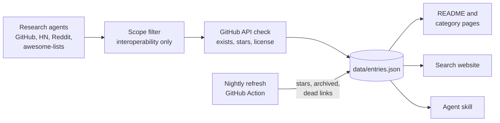

<div align="center">

<a href="https://alexgaoth.github.io/awesome-reverse-engineered/"></a>

<p><a href="README.md">English</a> · <a href="README.zh-CN.md">简体中文</a> · <b>Français</b> · <a href="README.es.md">Español</a></p>

### 10,238 outils open source qui existent parce que quelqu'un a fait la rétro-ingénierie d'un produit fermé : application, API, appareil, protocole, format de fichier, jeu ou outil d'IA.

[](https://awesome.re) [](#contenu) [](#contenu) [](.github/workflows/refresh.yml) [](data/entries.json) [](LICENSE)

[](#donnez-tout-lindex-à-votre-agent-ia) [](#donnez-tout-lindex-à-votre-agent-ia) [](https://github.com/alexgaoth/awesome-reverse-engineered/stargazers)

**[Rechercher dans l'index](https://alexgaoth.github.io/awesome-reverse-engineered/)** · **[Skill pour agents](#donnez-tout-lindex-à-votre-agent-ia)** · **[Catégories](#contenu)** · **[Populaires cette semaine](#populaires-cette-semaine)** · **[Proposer un projet](#contribuer)**

<sub>Les noms et descriptions des projets restent en anglais.</sub>

</div>

---

## Donnez tout l'index à votre agent IA

Quand une tâche doit communiquer avec quelque chose qui n'a pas d'API officielle (une prise connectée, une voiture, une messagerie, un format de fichier), votre agent cherche dans cet index, trie par étoiles, activité et licence, lit le README et choisit le bon outil.

```bash
npx skills add alexgaoth/awesome-reverse-engineered
```

<details><summary><b>Autres méthodes d'installation</b></summary>

**Plugin Claude Code**

```
/plugin install reverse-engineered --marketplace alexgaoth/awesome-reverse-engineered
```

**N'importe quel agent ou terminal (un seul fichier, uniquement la bibliothèque standard Python)**

```bash
curl -sL https://raw.githubusercontent.com/alexgaoth/awesome-reverse-engineered/main/skills/find-reverse-engineered/scripts/re_index.py -o re_index.py
python3 re_index.py search tuya local          # ranked matches
python3 re_index.py info make-all/tuya-local   # entry + README excerpt
python3 re_index.py clone make-all/tuya-local  # shallow clone into vendor/
```

</details>

<p align="center"></p>
<p align="center"><sub>Sortie réelle du skill sur les données actuelles.</sub></p>

## Rechercher sur le web

Filtrez 10,238 projets par catégorie, langage et état de santé, triés par étoiles ou par activité récente. Chaque recherche a un lien partageable.

<p align="center"><a href="https://alexgaoth.github.io/awesome-reverse-engineered/"></a></p>

<p align="center"><a href="https://alexgaoth.github.io/awesome-reverse-engineered/"><b>Ouvrir la recherche →</b></a></p>

## Contenu

**10,238 projets** qui cumulent **9.9 M** d'étoiles GitHub : 5,801 actifs, 1,587 au ralenti, 1,955 en sommeil, 718 archivés. Langages principaux : Python (2,590), C (1,502), C++ (1,443), JavaScript (611), TypeScript (537).

<p align="center"></p>

| Catégorie | Projets | Sélection |
|---|--:|---|
| [**Outils d'IA et clients LLM**](categories/ai-tools-llm-clients.md) | 683 | [claw-code](https://github.com/ultraworkers/claw-code), [system-prompts-and-models-of-ai-tools](https://github.com/x1xhlol/system-prompts-and-models-of-ai-tools), [system_prompts_leaks](https://github.com/asgeirtj/system_prompts_leaks) |
| [**Décompilations et réimplémentations de jeux**](categories/game-decompilations-reimplementations.md) | 2,644 | [shadPS4](https://github.com/shadps4-emu/shadPS4), [RPCS3](https://github.com/RPCS3/rpcs3), [OpenRA](https://github.com/OpenRA/OpenRA) |
| [**Appareils, IoT et matériel**](categories/devices-iot-hardware.md) | 1,877 | [KOReader](https://github.com/koreader/koreader), [LibrePods](https://github.com/librepods-org/librepods), [OpenLogi](https://github.com/AprilNEA/OpenLogi) |
| [**Clients d'API web et mobiles non officielles**](categories/unofficial-web-app-api-clients.md) | 653 | [yt-dlp](https://github.com/yt-dlp/yt-dlp), [youtube-dl](https://github.com/ytdl-org/youtube-dl), [MediaCrawler](https://github.com/NanmiCoder/MediaCrawler) |
| [**Messageries et réseaux sociaux**](categories/messaging-social-apps.md) | 255 | [WeChatMsg](https://github.com/LC044/WeChatMsg), [ItChat](https://github.com/littlecodersh/ItChat), [wechaty](https://github.com/wechaty/wechaty) |
| [**Clients tiers**](categories/third-party-clients.md) | 163 | [spotify-tui](https://github.com/Rigellute/spotify-tui), [nuclear](https://github.com/nukeop/nuclear), [SimpMusic](https://github.com/maxrave-dev/SimpMusic) |
| [**Plateformes chinoises et asiatiques**](categories/chinese-asian-platforms.md) | 293 | [lx-music-desktop](https://github.com/lyswhut/lx-music-desktop), [alist](https://github.com/AlistGo/alist), [12306](https://github.com/testerSunshine/12306) |
| [**Écosystème Apple**](categories/apple-ecosystem.md) | 326 | [fastlane](https://github.com/fastlane/fastlane), [homebridge](https://github.com/homebridge/homebridge), [OSX-KVM](https://github.com/kholia/OSX-KVM) |
| [**Pilotes et matériel bas niveau**](categories/drivers-low-level-hardware.md) | 376 | [MonitorControl](https://github.com/MonitorControl/MonitorControl), [tinygrad](https://github.com/tinygrad/tinygrad), [G-Helper](https://github.com/seerge/g-helper) |
| [**Automobile**](categories/automotive.md) | 355 | [openpilot](https://github.com/commaai/openpilot), [evcc](https://github.com/evcc-io/evcc), [VESC firmware](https://github.com/vedderb/bldc) |
| [**Automatisation industrielle et du bâtiment**](categories/industrial-building-automation.md) | 196 | [HslCommunication](https://github.com/dathlin/HslCommunication), [plc4x](https://github.com/apache/plc4x), [IoTClient](https://github.com/zhaopeiym/IoTClient) |
| [**Firmware et embarqué**](categories/firmware-embedded.md) | 350 | [LEDE (Lean)](https://github.com/coolsnowwolf/lede), [OpenWrt](https://github.com/openwrt/openwrt), [Tasmota](https://github.com/arendst/Tasmota) |
| [**Protocoles réseau et filaires**](categories/network-wire-protocols.md) | 376 | [Sunshine](https://github.com/LizardByte/Sunshine), [moonlight-qt](https://github.com/moonlight-stream/moonlight-qt), [Impacket](https://github.com/fortra/impacket) |
| [**Formats de fichiers**](categories/file-formats.md) | 379 | [FFmpeg](https://github.com/FFmpeg/FFmpeg), [ImHex](https://github.com/WerWolv/ImHex), [SheetJS](https://github.com/SheetJS/sheetjs) |
| [**Services en ligne ressuscités**](categories/online-service-revivals.md) | 168 | [NoLongerEvil Thermostat](https://github.com/codykociemba/NoLongerEvil-Thermostat), [Legacy Update](https://github.com/LegacyUpdate/LegacyUpdate), [wire-pod](https://github.com/kercre123/wire-pod) |
| [**Réimplémentations de logiciels de bureau**](categories/desktop-software-reimplementations.md) | 174 | [vaultwarden](https://github.com/dani-garcia/vaultwarden), [PhotoCraft](https://github.com/storytold/photocraft), [Proton](https://github.com/ValveSoftware/Proton) |
| [**Frontends alternatifs**](categories/alternative-frontends.md) | 113 | [searxng](https://github.com/searxng/searxng), [searx](https://github.com/searx/searx), [Whoogle Search](https://github.com/benbusby/whoogle-search) |
| [**Applications mobiles**](categories/mobile-apps.md) | 86 | [revanced-manager](https://github.com/ReVanced/revanced-manager), [Metrolist](https://github.com/MetrolistGroup/Metrolist), [LibreTube](https://github.com/libre-tube/LibreTube) |
| [**Outils de rétro-ingénierie**](categories/re-tooling.md) | 693 | [rea](https://github.com/morluto/rea), [Ghidra](https://github.com/NationalSecurityAgency/ghidra), [jadx](https://github.com/skylot/jadx) |
| [**Collections et listes Awesome**](categories/collections-awesome-lists.md) | 78 | [awesome reverse-engineering (wtsxDev)](https://github.com/wtsxDev/reverse-engineering), [android-security-awesome](https://github.com/ashishb/android-security-awesome), [mendel5/alternative-front-ends](https://github.com/mendel5/alternative-front-ends) |

## Populaires cette semaine

Les projets les plus étoilés qui ont reçu des commits ces 7 derniers jours.

| Projet | Ce qu'il fait | ★ | Santé | Langage |
|---|---|--:|:-:|---|
| [yt-dlp](https://github.com/yt-dlp/yt-dlp) | A feature-rich command-line audio/video downloader | 197,375 | 🟢 | Python |
| [claw-code](https://github.com/ultraworkers/claw-code) | Clean-room Rust/Python rewrite of the Claude Code agent harness after the source leak | 194,915 | 🟢 | Rust |
| [rea](https://github.com/morluto/rea) | Agentic tool to reverse engineer apps from behavior down to native binaries | 192,052 | 🟢 | TypeScript |
| [system-prompts-and-models-of-ai-tools](https://github.com/x1xhlol/system-prompts-and-models-of-ai-tools) | Extracted system prompts and tool definitions for Cursor, Claude Code, Devin, Windsurf, Kiro, v0, Lovable and more | 143,992 | 🟢 |  |
| [Ghidra](https://github.com/NationalSecurityAgency/ghidra) | NSA's software reverse engineering framework with decompiler | 85,939 | 🟢 | Java |
| [system_prompts_leaks](https://github.com/asgeirtj/system_prompts_leaks) | Archive of extracted system prompts from ChatGPT, Claude, Gemini, Grok and others, per vendor with history | 69,540 | 🟢 | Python |
| [vaultwarden](https://github.com/dani-garcia/vaultwarden) | Unofficial Bitwarden-compatible server written in Rust | 68,967 | 🟢 | Rust |
| [gpt4free](https://github.com/xtekky/gpt4free) | Reverse-engineered third-party provider APIs giving free access to GPT-4 and other LLMs | 66,818 | 🟢 | Python |
| [MediaCrawler](https://github.com/NanmiCoder/MediaCrawler) | Crawler for Xiaohongshu, Douyin, Kuaishou, Bilibili and Weibo posts and comments | 66,768 | 🟢 | Python |
| [FFmpeg](https://github.com/FFmpeg/FFmpeg) | Multimedia framework with many reverse-engineered proprietary codecs and containers | 65,091 | 🟢 | C |

## Ajouts récents

| Projet | Ce qu'il fait | ★ | Santé | Langage |
|---|---|--:|:-:|---|
| [ps2-web-recomp](https://github.com/snuri00/ps2-web-recomp) | PS2 games statically recompiled to WebAssembly with a native runtime to run in the browser | 579 | 🟢 | C++ |
| [Black-2006-Recomp](https://github.com/portingpete/Black-2006-Recomp) | Native Windows static recompilation of BLACK (2006) for the original Xbox | 44 | 🟢 | C |
| [Little Planet](https://github.com/carlosrmz009/littleplanet) | Sonic CD (Mega-CD) byte-identical disassembly plus static recompilation into a native PC port | 28 | 🟢 | Assembly |
| [Geometry Wars: Retro Evolved 2 Recompiled](https://github.com/saulob/geometry-wars-retro-evolved-2-recompiled) | Native PC port of Geometry Wars: Retro Evolved 2 (Xbox 360) via static recompilation | 26 | 🟢 | C++ |
| [AVP Ports Index](https://github.com/edgytoast/avp-ports-index) | Link-only index of community game ports (decomps, recomps) running natively on Apple Vision Pro | 20 | 🟢 | Python |
| [LightCraft Android](https://github.com/artcraft-android/lightcraft-android) | Reimplementation of Adobe Lightroom in Rust with a Kotlin Android UI | 17 | 🟢 | Rust |
| [ffta-recomp](https://github.com/james2doyle/ffta-recomp) | Native recompilation of Final Fantasy Tactics Advance (GBA) built on the gbarecomp framework | 16 | 🟢 | Python |
| [TooTawersRecomp](https://github.com/Gumpolas/TooTawersRecomp) | Native Windows port of The Lord of the Rings: The Two Towers (Xbox, 2002) via static recompilation | 15 | 🟢 |  |
| [dw2003recomp](https://github.com/gascarcella/dw2003recomp) | Decompilation of Digimon World 2003 (PS1, EU) with reference tests; PC port in progress | 14 | 🟢 | C |
| [MailCraft](https://github.com/MonkeySaint/mailcraft) | Clean-room reimplementation of Microsoft Outlook (classic) in pure Rust | 14 | 🟢 | Rust |
| [asmsense](https://github.com/krxi/asmsense) | Small model that names and describes functions in stripped x86-64 binaries, with open dataset | 13 | 🟢 | Python |
| [defjam_recomp](https://github.com/comoria08/defjam_recomp) | Static recompilation of Def Jam: Fight for NY (Xbox) for Windows | 13 | 🟢 | C |
| [Glover-R](https://github.com/ThatGuyMcd/Glover-R) | Static recompilation of the N64 game Glover to native PC | 12 | 🟢 | Python |
| [WWE-SVR2008-RECOMP](https://github.com/nefariousjosiah/WWE-SVR2008-RECOMP) | Native PC port of WWE SmackDown vs. Raw 2008 (Xbox 360) via static recompilation | 12 | 🟢 | C++ |
| [WWE-SVR2009-RECOMP](https://github.com/nefariousjosiah/WWE-SVR2009-RECOMP) | Native PC port of WWE SmackDown vs. Raw 2009 (Xbox 360) via static recompilation | 12 | 🟢 | C++ |

## Les plus étoilés

| # | Projet | Ce qu'il fait | ★ | Santé | Langage |
|--:|---|---|--:|:-:|---|
| 1 | [yt-dlp](https://github.com/yt-dlp/yt-dlp) | A feature-rich command-line audio/video downloader | 197,375 | 🟢 | Python |
| 2 | [claw-code](https://github.com/ultraworkers/claw-code) | Clean-room Rust/Python rewrite of the Claude Code agent harness after the source leak | 194,915 | 🟢 | Rust |
| 3 | [rea](https://github.com/morluto/rea) | Agentic tool to reverse engineer apps from behavior down to native binaries | 192,052 | 🟢 | TypeScript |
| 4 | [system-prompts-and-models-of-ai-tools](https://github.com/x1xhlol/system-prompts-and-models-of-ai-tools) | Extracted system prompts and tool definitions for Cursor, Claude Code, Devin, Windsurf, Kiro, v0, Lovable and more | 143,992 | 🟢 |  |
| 5 | [youtube-dl](https://github.com/ytdl-org/youtube-dl) | Command-line program to download videos from YouTube.com and other video sites | 141,287 | 🟢 | Python |
| 6 | [Ghidra](https://github.com/NationalSecurityAgency/ghidra) | NSA's software reverse engineering framework with decompiler | 85,939 | 🟢 | Java |
| 7 | [system_prompts_leaks](https://github.com/asgeirtj/system_prompts_leaks) | Archive of extracted system prompts from ChatGPT, Claude, Gemini, Grok and others, per vendor with history | 69,540 | 🟢 | Python |
| 8 | [vaultwarden](https://github.com/dani-garcia/vaultwarden) | Unofficial Bitwarden-compatible server written in Rust | 68,967 | 🟢 | Rust |
| 9 | [gpt4free](https://github.com/xtekky/gpt4free) | Reverse-engineered third-party provider APIs giving free access to GPT-4 and other LLMs | 66,818 | 🟢 | Python |
| 10 | [MediaCrawler](https://github.com/NanmiCoder/MediaCrawler) | Crawler for Xiaohongshu, Douyin, Kuaishou, Bilibili and Weibo posts and comments | 66,768 | 🟢 | Python |
| 11 | [FFmpeg](https://github.com/FFmpeg/FFmpeg) | Multimedia framework with many reverse-engineered proprietary codecs and containers | 65,091 | 🟢 | C |
| 12 | [openpilot](https://github.com/commaai/openpilot) | Open-source driver assistance system for 300+ car models | 63,891 | 🟢 | Python |
| 13 | [PhotoCraft](https://github.com/storytold/photocraft) | Clean-room Photoshop-style photo editor written from scratch in pure Rust | 56,243 | 🟢 | Rust |
| 14 | [ImHex](https://github.com/WerWolv/ImHex) | Hex editor for reverse engineers with a pattern language for binary formats | 55,127 | 🟢 | C++ |
| 15 | [CLIProxyAPI](https://github.com/router-for-me/CLIProxyAPI) | Wraps Codex, Claude Code, Antigravity, Grok and Gemini CLI OAuth backends as OpenAI/Claude-compatible APIs | 55,055 | 🟢 | Go |
| 16 | [lx-music-desktop](https://github.com/lyswhut/lx-music-desktop) | LX Music: desktop music player aggregating Chinese music platform sources | 54,409 | 🟢 | TypeScript |
| 17 | [CL4R1T4S](https://github.com/elder-plinius/CL4R1T4S) | Leaked system prompts and tool specs for ChatGPT, Claude, Gemini, Grok, Perplexity, Cursor, Lovable, Replit and others | 51,183 | 🟢 |  |
| 18 | [jadx](https://github.com/skylot/jadx) | Dex to Java decompiler for Android apps | 50,892 | 🟢 | Java |
| 19 | [alist](https://github.com/AlistGo/alist) | AList: file list and WebDAV server that mounts many cloud drives through their private APIs | 50,285 | 🟢 | Go |
| 20 | [Spotube](https://github.com/team-spotube/spotube) | Cross-platform Spotify client that streams audio from other sources | 49,857 | 🟢 | Dart |
| 21 | [x64dbg](https://github.com/x64dbg/x64dbg) | Open source user-mode debugger for Windows | 49,831 | 🟢 | C++ |
| 22 | [mitmproxy](https://github.com/mitmproxy/mitmproxy) | Interactive TLS-capable intercepting HTTP proxy | 45,494 | 🟢 | Python |
| 23 | [sub2api](https://github.com/Wei-Shaw/sub2api) | Relay that exposes Claude, OpenAI, Gemini and Grok subscriptions as unified APIs | 43,885 | 🟢 | Go |
| 24 | [fastlane](https://github.com/fastlane/fastlane) | iOS/Android release automation; its spaceship module wraps Apple's private developer portal and App Store Connect APIs | 42,242 | 🟢 | Ruby |
| 25 | [Sunshine](https://github.com/LizardByte/Sunshine) | Self-hosted game stream host that implements the NVIDIA GameStream protocol for Moonlight clients | 42,178 | 🟢 | C++ |

## Santé

| | Signification |
|:-:|---|
| 🟢 | Actif : push dans les 12 derniers mois |
| 🟡 | Au ralenti : dernier push il y a 1 à 3 ans |
| 🔴 | En sommeil : aucun push depuis plus de 3 ans |
| 🗄️ | Archivé par son propriétaire |
| ⚪ | Inconnu : non hébergé sur GitHub |

Les API non officielles cassent dès que l'éditeur change quelque chose de son côté. Vérifiez la santé d'un projet avant d'en dépendre.

## Comment c'est construit



Données brutes : [`data/entries.json`](data/entries.json). Dépôts retirés : [`data/removed.json`](data/removed.json). Listes importées et recherches : [SOURCES.md](SOURCES.md).

## Périmètre

Cet index recense des projets d'**interopérabilité, de préservation et de recherche** : clients et SDK non officiels, pilotes libres, bibliothèques de contrôle local, parseurs de formats de fichiers, documentation de protocoles, réimplémentations et décompilations. La rétro-ingénierie à des fins d'interopérabilité est protégée dans de nombreux pays (par exemple 17 U.S.C. §1201(f) et l'article 6 de la directive européenne sur les programmes d'ordinateur).

**Exclus volontairement :** exploits et jailbreaks, contournement de sécurité ou de certificate pinning, outils de déchiffrement, triche, suppression de DRM ou de paywall, solveurs de CAPTCHA, bots de comptes et outils d'identifiants.

Utiliser un client non officiel peut enfreindre les conditions d'utilisation d'un service. Utilisez ces projets avec vos propres comptes, appareils et données.

## Contribuer

Vous connaissez un projet qui a sa place ici ? [Ouvrez une issue](https://github.com/alexgaoth/awesome-reverse-engineered/issues/new?title=Add%3A%20&body=Repo%3A%20%0AWhat%20it%20reverse%20engineers%3A%20) avec le lien du dépôt et une ligne sur ce qu'il rétro-conçoit, ou envoyez une PR qui l'ajoute à `data/entries.json`. Mauvaise catégorie, lien mort ou hors périmètre ? Ouvrez aussi une issue.

Organisé par [@alexgaoth](https://github.com/alexgaoth) avec des agents de recherche. Chaque entrée est vérifiée avec l'API GitHub.

## Historique des étoiles

<a href="https://star-history.com/#alexgaoth/awesome-reverse-engineered&Date"></a>

## Licence

[CC0 1.0](LICENSE) pour la liste elle-même. Chaque projet référencé a sa propre licence.

<div align="center">

**Si cet index vous a évité de faire de la rétro-ingénierie vous-même, [mettez-lui une étoile](https://github.com/alexgaoth/awesome-reverse-engineered).**

</div>
