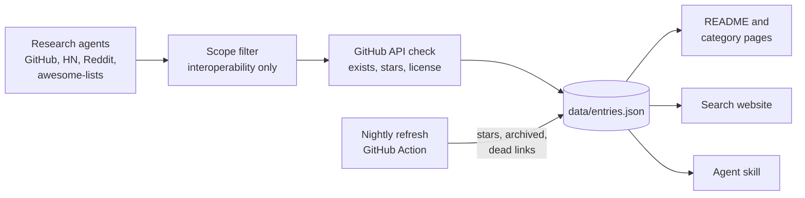

<div align="center">

<a href="https://alexgaoth.github.io/awesome-reverse-engineered/"></a>

<p><b>English</b> · <a href="README.zh-CN.md">简体中文</a> · <a href="README.fr.md">Français</a> · <a href="README.es.md">Español</a></p>

### 11,942 open-source tools that exist because someone reverse engineered a closed app, API, device, protocol, file format, game or AI product.

[](https://awesome.re) [](#whats-inside) [](#whats-inside) [](.github/workflows/refresh.yml) [](data/entries.json) [](LICENSE)

[](#give-your-ai-agent-the-whole-index) [](#give-your-ai-agent-the-whole-index) [](https://github.com/alexgaoth/awesome-reverse-engineered/stargazers)

**[Search the index](https://alexgaoth.github.io/awesome-reverse-engineered/)** · **[Agent skill](#give-your-ai-agent-the-whole-index)** · **[Categories](#whats-inside)** · **[Hot this week](#hot-this-week)** · **[Add a project](#contributing)**

</div>

---

## Give your AI agent the whole index

When a task needs to talk to something with no official API (a smart plug, a car, a chat app, a file format), your agent searches this index, ranks by stars, activity and license, reads the README, and picks the right tool.

```bash
npx skills add alexgaoth/awesome-reverse-engineered
```

<details><summary><b>Other ways to install</b></summary>

**Claude Code plugin**

```
/plugin install reverse-engineered --marketplace alexgaoth/awesome-reverse-engineered
```

**Any agent or shell (one file, Python standard library only)**

```bash
curl -sL https://raw.githubusercontent.com/alexgaoth/awesome-reverse-engineered/main/plugin/skills/find-reverse-engineered/scripts/re_index.py -o re_index.py
python3 re_index.py search tuya local          # ranked matches
python3 re_index.py info make-all/tuya-local   # entry + README excerpt
python3 re_index.py clone make-all/tuya-local  # shallow clone into vendor/
```

</details>

<p align="center"></p>
<p align="center"><sub>Real output of the skill on the current data.</sub></p>

## Search it on the web

Filter 11,942 projects by category, language and health, sorted by stars or recent activity. Every search has a shareable link.

<p align="center"><a href="https://alexgaoth.github.io/awesome-reverse-engineered/"></a></p>

<p align="center"><a href="https://alexgaoth.github.io/awesome-reverse-engineered/"><b>Open the search →</b></a></p>

## What's inside

**11,942 projects** with **10.3M** GitHub stars between them: 6,677 active, 1,806 slowing down, 2,205 dormant, 806 archived. Top languages: Python (3,029), C++ (1,774), C (1,624), JavaScript (730), TypeScript (667).

<p align="center"></p>

| Category | Projects | Top picks |
|---|--:|---|
| [**AI Tools & LLM Clients**](categories/ai-tools-llm-clients.md) | 726 | [claw-code](https://github.com/ultraworkers/claw-code), [system-prompts-and-models-of-ai-tools](https://github.com/x1xhlol/system-prompts-and-models-of-ai-tools), [system_prompts_leaks](https://github.com/asgeirtj/system_prompts_leaks) |
| [**Game Decompilations & Reimplementations**](categories/game-decompilations-reimplementations.md) | 3,020 | [shadPS4](https://github.com/shadps4-emu/shadPS4), [v86](https://github.com/copy/v86), [RPCS3](https://github.com/RPCS3/rpcs3) |
| [**Devices, IoT & Hardware**](categories/devices-iot-hardware.md) | 2,538 | [KOReader](https://github.com/koreader/koreader), [LibrePods](https://github.com/librepods-org/librepods), [OpenLogi](https://github.com/AprilNEA/OpenLogi) |
| [**Unofficial Web/App API Clients**](categories/unofficial-web-app-api-clients.md) | 807 | [yt-dlp](https://github.com/yt-dlp/yt-dlp), [youtube-dl](https://github.com/ytdl-org/youtube-dl), [MediaCrawler](https://github.com/NanmiCoder/MediaCrawler) |
| [**Messaging & Social Apps**](categories/messaging-social-apps.md) | 278 | [WeChatMsg](https://github.com/LC044/WeChatMsg), [ItChat](https://github.com/littlecodersh/ItChat), [wechaty](https://github.com/wechaty/wechaty) |
| [**Third-party Clients**](categories/third-party-clients.md) | 160 | [spotify-tui](https://github.com/Rigellute/spotify-tui), [nuclear](https://github.com/nukeop/nuclear), [SimpMusic](https://github.com/maxrave-dev/SimpMusic) |
| [**Chinese & Asian Platforms**](categories/chinese-asian-platforms.md) | 313 | [lx-music-desktop](https://github.com/lyswhut/lx-music-desktop), [alist](https://github.com/AlistGo/alist), [12306](https://github.com/testerSunshine/12306) |
| [**Apple Ecosystem**](categories/apple-ecosystem.md) | 336 | [fastlane](https://github.com/fastlane/fastlane), [homebridge](https://github.com/homebridge/homebridge), [OSX-KVM](https://github.com/kholia/OSX-KVM) |
| [**Drivers & Low-level Hardware**](categories/drivers-low-level-hardware.md) | 415 | [MonitorControl](https://github.com/MonitorControl/MonitorControl), [tinygrad](https://github.com/tinygrad/tinygrad), [G-Helper](https://github.com/seerge/g-helper) |
| [**Automotive**](categories/automotive.md) | 391 | [openpilot](https://github.com/commaai/openpilot), [evcc](https://github.com/evcc-io/evcc), [VESC firmware](https://github.com/vedderb/bldc) |
| [**Industrial & Building Automation**](categories/industrial-building-automation.md) | 268 | [HslCommunication](https://github.com/dathlin/HslCommunication), [plc4x](https://github.com/apache/plc4x), [IoTClient](https://github.com/zhaopeiym/IoTClient) |
| [**Firmware & Embedded**](categories/firmware-embedded.md) | 419 | [LEDE (Lean)](https://github.com/coolsnowwolf/lede), [OpenWrt](https://github.com/openwrt/openwrt), [Tasmota](https://github.com/arendst/Tasmota) |
| [**Network & Wire Protocols**](categories/network-wire-protocols.md) | 415 | [Sunshine](https://github.com/LizardByte/Sunshine), [moonlight-qt](https://github.com/moonlight-stream/moonlight-qt), [Impacket](https://github.com/fortra/impacket) |
| [**File Formats**](categories/file-formats.md) | 425 | [FFmpeg](https://github.com/FFmpeg/FFmpeg), [ImHex](https://github.com/WerWolv/ImHex), [SheetJS](https://github.com/SheetJS/sheetjs) |
| [**Online Service Revivals**](categories/online-service-revivals.md) | 169 | [NoLongerEvil Thermostat](https://github.com/codykociemba/NoLongerEvil-Thermostat), [Legacy Update](https://github.com/LegacyUpdate/LegacyUpdate), [wire-pod](https://github.com/kercre123/wire-pod) |
| [**Desktop Software Reimplementations**](categories/desktop-software-reimplementations.md) | 201 | [vaultwarden](https://github.com/dani-garcia/vaultwarden), [PhotoCraft](https://github.com/storytold/photocraft), [Proton](https://github.com/ValveSoftware/Proton) |
| [**Alternative Frontends**](categories/alternative-frontends.md) | 121 | [searxng](https://github.com/searxng/searxng), [searx](https://github.com/searx/searx), [Whoogle Search](https://github.com/benbusby/whoogle-search) |
| [**Mobile Apps**](categories/mobile-apps.md) | 102 | [revanced-manager](https://github.com/ReVanced/revanced-manager), [Metrolist](https://github.com/MetrolistGroup/Metrolist), [LibreTube](https://github.com/libre-tube/LibreTube) |
| [**RE Tooling**](categories/re-tooling.md) | 737 | [rea](https://github.com/morluto/rea), [Ghidra](https://github.com/NationalSecurityAgency/ghidra), [jadx](https://github.com/skylot/jadx) |
| [**Collections & Awesome Lists**](categories/collections-awesome-lists.md) | 101 | [awesome reverse-engineering (wtsxDev)](https://github.com/wtsxDev/reverse-engineering), [android-security-awesome](https://github.com/ashishb/android-security-awesome), [mendel5/alternative-front-ends](https://github.com/mendel5/alternative-front-ends) |

## Hot this week

The most-starred projects with commits in the last 7 days.

| Project | What it does | ★ | Health | Lang |
|---|---|--:|:-:|---|
| [rea](https://github.com/morluto/rea) | Agentic tool to reverse engineer apps from behavior down to native binaries | 226,440 | 🟢 | TypeScript |
| [yt-dlp](https://github.com/yt-dlp/yt-dlp) | A feature-rich command-line audio/video downloader | 197,653 | 🟢 | Python |
| [claw-code](https://github.com/ultraworkers/claw-code) | Clean-room Rust/Python rewrite of the Claude Code agent harness after the source leak | 194,890 | 🟢 | Rust |
| [system-prompts-and-models-of-ai-tools](https://github.com/x1xhlol/system-prompts-and-models-of-ai-tools) | Extracted system prompts and tool definitions for Cursor, Claude Code, Devin, Windsurf, Kiro, v0, Lovable and more | 144,019 | 🟢 |  |
| [Ghidra](https://github.com/NationalSecurityAgency/ghidra) | NSA's software reverse engineering framework with decompiler | 86,803 | 🟢 | Java |
| [system_prompts_leaks](https://github.com/asgeirtj/system_prompts_leaks) | Archive of extracted system prompts from ChatGPT, Claude, Gemini, Grok and others, per vendor with history | 69,601 | 🟢 | Python |
| [vaultwarden](https://github.com/dani-garcia/vaultwarden) | Unofficial Bitwarden-compatible server written in Rust | 69,023 | 🟢 | Rust |
| [MediaCrawler](https://github.com/NanmiCoder/MediaCrawler) | Crawler for Xiaohongshu, Douyin, Kuaishou, Bilibili and Weibo posts and comments | 66,848 | 🟢 | Python |
| [gpt4free](https://github.com/xtekky/gpt4free) | Reverse-engineered third-party provider APIs giving free access to GPT-4 and other LLMs | 66,843 | 🟢 | Python |
| [FFmpeg](https://github.com/FFmpeg/FFmpeg) | Multimedia framework with many reverse-engineered proprietary codecs and containers | 65,142 | 🟢 | C |

## Just added

| Project | What it does | ★ | Health | Lang |
|---|---|--:|:-:|---|
| [v86](https://github.com/copy/v86) | v86, an x86 PC emulator and x86-to-wasm JIT running in the browser | 23,577 | 🟢 | JavaScript |
| [claude-code-best](https://github.com/claude-code-best/claude-code) | Reverse-engineered rebuild of the Anthropic Claude Code CLI as an open terminal coding assistant | 22,905 | 🟢 | TypeScript |
| [ppsspp](https://github.com/hrydgard/ppsspp) | PPSSPP, a PSP emulator for Android, Windows, macOS, Linux and iOS | 14,655 | 🟢 | C++ |
| [electronic-wechat](https://github.com/zhongyi-tong/electronic-wechat) | Electron WeChat client for macOS and Linux wrapping web WeChat | 13,815 | 🗄️ | JavaScript |
| [mame](https://github.com/mamedev/mame) | MAME, the multi-system arcade and computer emulator | 10,604 | 🟢 | C++ |
| [Cemu](https://github.com/cemu-project/Cemu) | Cemu, a Wii U emulator | 9,986 | 🟢 | C++ |
| [universal-modder](https://github.com/rehan-remade/universal-modder) | Skills and tools that let AI coding agents reverse engineer and mod almost any PC game | 7,537 | 🟢 | Python |
| [mgba](https://github.com/mgba-emu/mgba) | mGBA, an accurate Game Boy Advance emulator | 7,496 | 🟢 | C |
| [WeixinBot](https://github.com/Urinx/WeixinBot) | Web WeChat API with a terminal client and bot | 7,410 | 🔴 | Python |
| [jsnes](https://github.com/bfirsh/jsnes) | jsnes, a JavaScript NES emulator | 6,426 | 🟢 | JavaScript |
| [capa](https://github.com/mandiant/capa) | FLARE tool that identifies capabilities in executable files | 6,235 | 🟢 | Python |
| [wxBot](https://github.com/liuwons/wxBot) | Python WeChat personal-account bot framework on the web protocol (deprecated) | 5,312 | 🔴 | Python |
| [PyBoy](https://github.com/Baekalfen/PyBoy) | Game Boy emulator written in Python, with an API for scripting and AI agents | 5,224 | 🟢 | Python |
| [SimpleNES](https://github.com/amhndu/SimpleNES) | SimpleNES, an NES emulator in C++ | 5,115 | 🟡 | C++ |
| [melonDS](https://github.com/melonDS-emu/melonDS) | melonDS, a Nintendo DS emulator with DSi and local wireless support | 5,110 | 🟢 | C++ |

## Most starred

| # | Project | What it does | ★ | Health | Lang |
|--:|---|---|--:|:-:|---|
| 1 | [rea](https://github.com/morluto/rea) | Agentic tool to reverse engineer apps from behavior down to native binaries | 226,440 | 🟢 | TypeScript |
| 2 | [yt-dlp](https://github.com/yt-dlp/yt-dlp) | A feature-rich command-line audio/video downloader | 197,653 | 🟢 | Python |
| 3 | [claw-code](https://github.com/ultraworkers/claw-code) | Clean-room Rust/Python rewrite of the Claude Code agent harness after the source leak | 194,890 | 🟢 | Rust |
| 4 | [system-prompts-and-models-of-ai-tools](https://github.com/x1xhlol/system-prompts-and-models-of-ai-tools) | Extracted system prompts and tool definitions for Cursor, Claude Code, Devin, Windsurf, Kiro, v0, Lovable and more | 144,019 | 🟢 |  |
| 5 | [youtube-dl](https://github.com/ytdl-org/youtube-dl) | Command-line program to download videos from YouTube.com and other video sites | 141,304 | 🟢 | Python |
| 6 | [Ghidra](https://github.com/NationalSecurityAgency/ghidra) | NSA's software reverse engineering framework with decompiler | 86,803 | 🟢 | Java |
| 7 | [system_prompts_leaks](https://github.com/asgeirtj/system_prompts_leaks) | Archive of extracted system prompts from ChatGPT, Claude, Gemini, Grok and others, per vendor with history | 69,601 | 🟢 | Python |
| 8 | [vaultwarden](https://github.com/dani-garcia/vaultwarden) | Unofficial Bitwarden-compatible server written in Rust | 69,023 | 🟢 | Rust |
| 9 | [MediaCrawler](https://github.com/NanmiCoder/MediaCrawler) | Crawler for Xiaohongshu, Douyin, Kuaishou, Bilibili and Weibo posts and comments | 66,848 | 🟢 | Python |
| 10 | [gpt4free](https://github.com/xtekky/gpt4free) | Reverse-engineered third-party provider APIs giving free access to GPT-4 and other LLMs | 66,843 | 🟢 | Python |
| 11 | [FFmpeg](https://github.com/FFmpeg/FFmpeg) | Multimedia framework with many reverse-engineered proprietary codecs and containers | 65,142 | 🟢 | C |
| 12 | [openpilot](https://github.com/commaai/openpilot) | Open-source driver assistance system for 300+ car models | 63,898 | 🟢 | Python |
| 13 | [PhotoCraft](https://github.com/storytold/photocraft) | Clean-room Photoshop-style photo editor written from scratch in pure Rust | 59,554 | 🟢 | Rust |
| 14 | [CLIProxyAPI](https://github.com/router-for-me/CLIProxyAPI) | Wraps Codex, Claude Code, Antigravity, Grok and Gemini CLI OAuth backends as OpenAI/Claude-compatible APIs | 55,181 | 🟢 | Go |
| 15 | [ImHex](https://github.com/WerWolv/ImHex) | Hex editor for reverse engineers with a pattern language for binary formats | 55,177 | 🟢 | C++ |
| 16 | [lx-music-desktop](https://github.com/lyswhut/lx-music-desktop) | LX Music: desktop music player aggregating Chinese music platform sources | 54,434 | 🟢 | TypeScript |
| 17 | [CL4R1T4S](https://github.com/elder-plinius/CL4R1T4S) | Leaked system prompts and tool specs for ChatGPT, Claude, Gemini, Grok, Perplexity, Cursor, Lovable, Replit and others | 51,224 | 🟢 |  |
| 18 | [jadx](https://github.com/skylot/jadx) | Dex to Java decompiler for Android apps | 50,934 | 🟢 | Java |
| 19 | [alist](https://github.com/AlistGo/alist) | AList: file list and WebDAV server that mounts many cloud drives through their private APIs | 50,296 | 🟢 | Go |
| 20 | [Spotube](https://github.com/team-spotube/spotube) | Cross-platform Spotify client that streams audio from other sources | 49,905 | 🟢 | Dart |
| 21 | [x64dbg](https://github.com/x64dbg/x64dbg) | Open source user-mode debugger for Windows | 49,862 | 🟢 | C++ |
| 22 | [mitmproxy](https://github.com/mitmproxy/mitmproxy) | Interactive TLS-capable intercepting HTTP proxy | 45,569 | 🟢 | Python |
| 23 | [sub2api](https://github.com/Wei-Shaw/sub2api) | Relay that exposes Claude, OpenAI, Gemini and Grok subscriptions as unified APIs | 43,986 | 🟢 | Go |
| 24 | [fastlane](https://github.com/fastlane/fastlane) | iOS/Android release automation; its spaceship module wraps Apple's private developer portal and App Store Connect APIs | 42,246 | 🟢 | Ruby |
| 25 | [Sunshine](https://github.com/LizardByte/Sunshine) | Self-hosted game stream host that implements the NVIDIA GameStream protocol for Moonlight clients | 42,206 | 🟢 | C++ |

## Health

| | Meaning |
|:-:|---|
| 🟢 | Active: pushed in the last 12 months |
| 🟡 | Slowing: last push 1 to 3 years ago |
| 🔴 | Dormant: no push for over 3 years |
| 🗄️ | Archived by its owner |
| ⚪ | Unknown: not hosted on GitHub |

Unofficial APIs break when the vendor changes their side, so check health before you depend on a project.

## How it's built



Raw data: [`data/entries.json`](data/entries.json). Removed repos: [`data/removed.json`](data/removed.json). Imported lists and searches: [SOURCES.md](SOURCES.md).

## Scope

This index lists **interoperability, preservation and research** projects: unofficial clients and SDKs, open drivers, local-control libraries, file-format parsers, protocol documentation, reimplementations and decompilations. Reverse engineering for interoperability is protected in many places (for example 17 U.S.C. §1201(f) and Article 6 of the EU Software Directive).

**Left out on purpose:** exploits and jailbreaks, security or certificate-pinning bypasses, decryption tools, cheats, DRM or paywall removal, CAPTCHA solvers, account bots and credential tools.

Using an unofficial client can break a service's terms of use. Use these projects with your own accounts, devices and data.

## Contributing

Know a project that belongs here? [Open an issue](https://github.com/alexgaoth/awesome-reverse-engineered/issues/new?title=Add%3A%20&body=Repo%3A%20%0AWhat%20it%20reverse%20engineers%3A%20) with the repo link and one line on what it reverse engineers, or send a PR that adds it to `data/entries.json`. Wrong category, dead link, or out of scope? Open an issue too.

Curated by [@alexgaoth](https://github.com/alexgaoth) with research agents. Every entry is checked against the GitHub API.

## Star history

<a href="https://star-history.com/#alexgaoth/awesome-reverse-engineered&Date"></a>

## License

Code (scripts, website, agent skill): [MIT](LICENSE). The list and data: [CC0 1.0](LICENSE-DATA). Each linked project has its own license.

<div align="center">

**If this saved you from reverse engineering something yourself, [give it a star](https://github.com/alexgaoth/awesome-reverse-engineered).**

</div>
