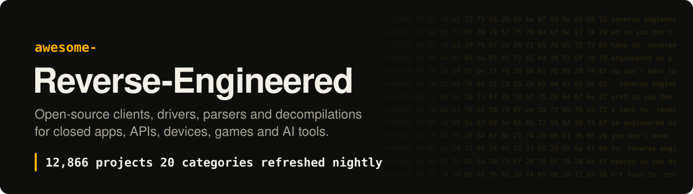
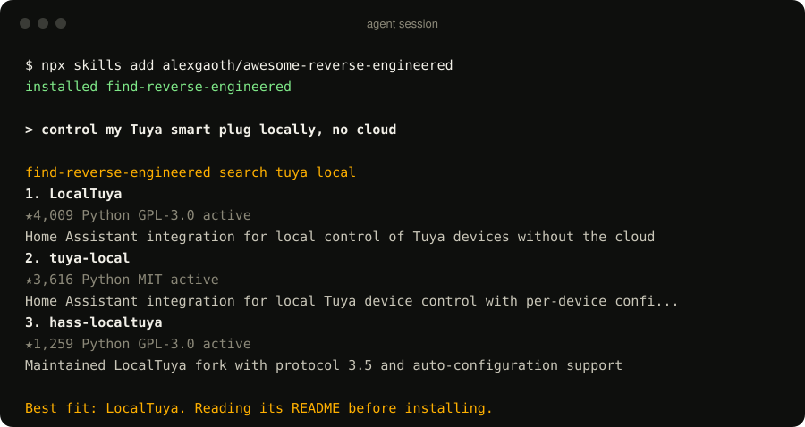
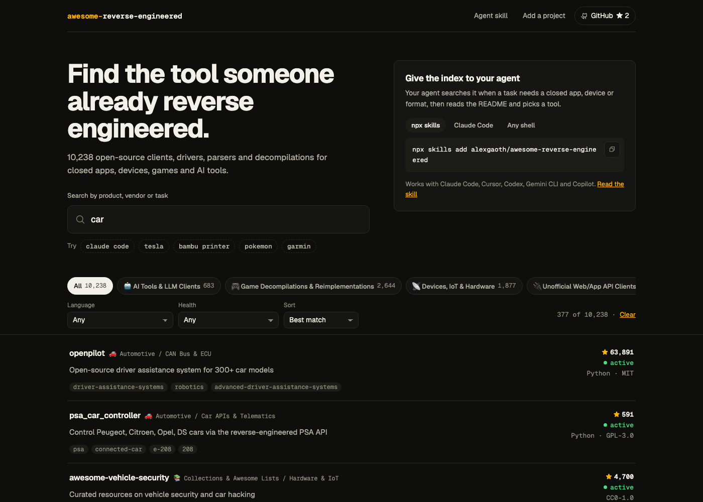
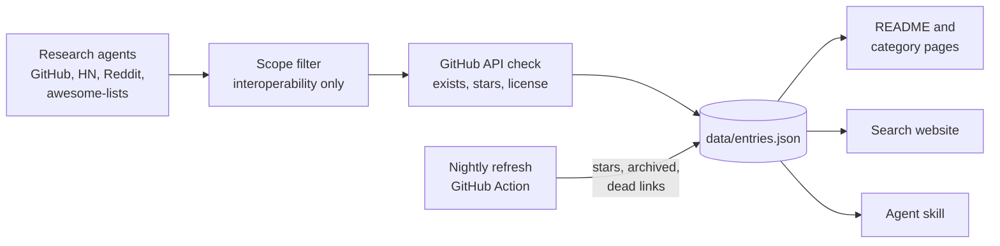
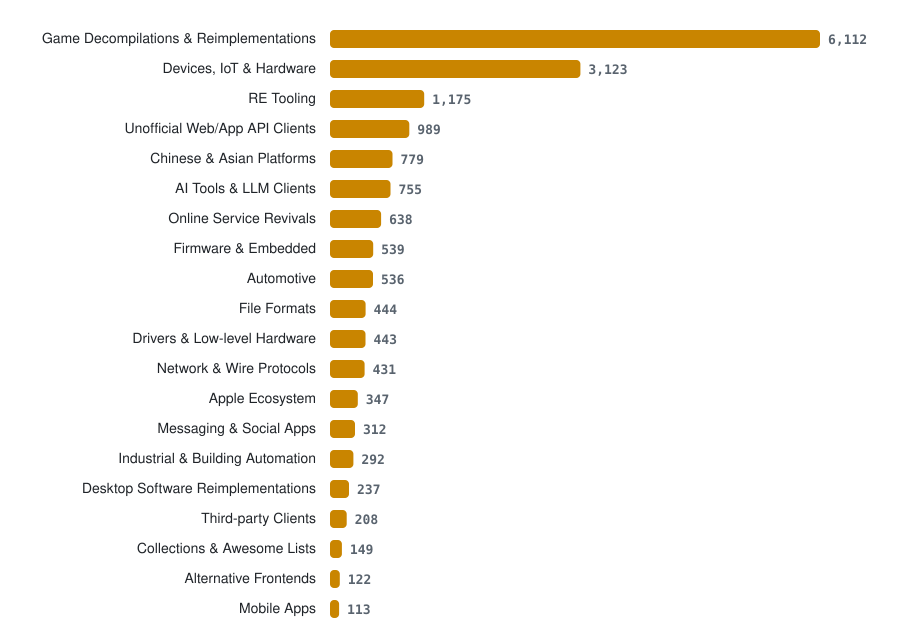

<div align="center">

<a href="https://alexgaoth.github.io/awesome-reverse-engineered/"></a>

<p><b>English</b> · <a href="README.zh-CN.md">简体中文</a> · <a href="README.fr.md">Français</a> · <a href="README.es.md">Español</a> · <a href="README.vi.md">Tiếng Việt</a> · <a href="README.pt-BR.md">Português (BR)</a></p>

## Don't reverse engineer it twice.

16,844 open-source tools that exist because someone reverse engineered a closed app, API, device, protocol, file format, game or AI product.

**[Search the index](https://alexgaoth.github.io/awesome-reverse-engineered/)** or give it to your agent: `npx skills add alexgaoth/awesome-reverse-engineered`

[](https://awesome.re) [](#whats-inside) [](.github/workflows/refresh.yml) [](https://github.com/alexgaoth/awesome-reverse-engineered/stargazers) [](LICENSE)

**[Agent skill](#give-your-ai-agent-the-whole-index)** · **[Categories](#whats-inside)** · **[Hot this week](#hot-this-week)** · **[Add a project](#contributing)**

</div>

---

## Before you reverse engineer something

Agents and tools like [REA](https://github.com/morluto/rea) and [Ghidra](https://github.com/NationalSecurityAgency/ghidra) make reverse engineering faster than ever. Still, the app, API, device or file format you are about to open has often been done already, and the work sits in a repo nobody links to.

1. **Search first.** Use the [website](https://alexgaoth.github.io/awesome-reverse-engineered/) or the [agent skill](#give-your-ai-agent-the-whole-index). Search by product, vendor or protocol.
2. **Found it?** Use it, fix it, and report breakage upstream. One maintained client beats ten private scripts.
3. **Not there?** Do the work, publish it as open source, then [add it here](#contributing) so the next person starts where you stopped.

## What's inside

**16,844 projects** with **11.1M** GitHub stars between them: 9,730 active, 2,379 slowing down, 3,231 dormant, 1,046 archived. Top languages: Python (3,796), C++ (2,612), C (2,507), JavaScript (987), C# (902).

| Category | Projects | Top picks |
|---|--:|---|
| [**AI Tools & LLM Clients**](categories/ai-tools-llm-clients.md) | 742 | [claw-code](https://github.com/ultraworkers/claw-code), [system-prompts-and-models-of-ai-tools](https://github.com/x1xhlol/system-prompts-and-models-of-ai-tools), [system_prompts_leaks](https://github.com/asgeirtj/system_prompts_leaks) |
| [**Game Decompilations & Reimplementations**](categories/game-decompilations-reimplementations.md) | 6,098 | [shadPS4](https://github.com/shadps4-emu/shadPS4), [v86](https://github.com/copy/v86), [RPCS3](https://github.com/RPCS3/rpcs3) |
| [**Devices, IoT & Hardware**](categories/devices-iot-hardware.md) | 3,060 | [KOReader](https://github.com/koreader/koreader), [LibrePods](https://github.com/librepods-org/librepods), [OpenLogi](https://github.com/AprilNEA/OpenLogi) |
| [**Unofficial Web/App API Clients**](categories/unofficial-web-app-api-clients.md) | 908 | [yt-dlp](https://github.com/yt-dlp/yt-dlp), [youtube-dl](https://github.com/ytdl-org/youtube-dl), [MediaCrawler](https://github.com/NanmiCoder/MediaCrawler) |
| [**Messaging & Social Apps**](categories/messaging-social-apps.md) | 297 | [WeChatMsg](https://github.com/LC044/WeChatMsg), [ItChat](https://github.com/littlecodersh/ItChat), [wechaty](https://github.com/wechaty/wechaty) |
| [**Third-party Clients**](categories/third-party-clients.md) | 190 | [spotify-tui](https://github.com/Rigellute/spotify-tui), [nuclear](https://github.com/nukeop/nuclear), [SimpMusic](https://github.com/maxrave-dev/SimpMusic) |
| [**Chinese & Asian Platforms**](categories/chinese-asian-platforms.md) | 328 | [lx-music-desktop](https://github.com/lyswhut/lx-music-desktop), [alist](https://github.com/AlistGo/alist), [12306](https://github.com/testerSunshine/12306) |
| [**Apple Ecosystem**](categories/apple-ecosystem.md) | 344 | [fastlane](https://github.com/fastlane/fastlane), [homebridge](https://github.com/homebridge/homebridge), [OSX-KVM](https://github.com/kholia/OSX-KVM) |
| [**Drivers & Low-level Hardware**](categories/drivers-low-level-hardware.md) | 442 | [MonitorControl](https://github.com/MonitorControl/MonitorControl), [tinygrad](https://github.com/tinygrad/tinygrad), [G-Helper](https://github.com/seerge/g-helper) |
| [**Automotive**](categories/automotive.md) | 525 | [openpilot](https://github.com/commaai/openpilot), [evcc](https://github.com/evcc-io/evcc), [VESC firmware](https://github.com/vedderb/bldc) |
| [**Industrial & Building Automation**](categories/industrial-building-automation.md) | 291 | [HslCommunication](https://github.com/dathlin/HslCommunication), [plc4x](https://github.com/apache/plc4x), [IoTClient](https://github.com/zhaopeiym/IoTClient) |
| [**Firmware & Embedded**](categories/firmware-embedded.md) | 494 | [LEDE (Lean)](https://github.com/coolsnowwolf/lede), [OpenWrt](https://github.com/openwrt/openwrt), [Tasmota](https://github.com/arendst/Tasmota) |
| [**Network & Wire Protocols**](categories/network-wire-protocols.md) | 426 | [Sunshine](https://github.com/LizardByte/Sunshine), [moonlight-qt](https://github.com/moonlight-stream/moonlight-qt), [Impacket](https://github.com/fortra/impacket) |
| [**File Formats**](categories/file-formats.md) | 440 | [FFmpeg](https://github.com/FFmpeg/FFmpeg), [ImHex](https://github.com/WerWolv/ImHex), [SheetJS](https://github.com/SheetJS/sheetjs) |
| [**Online Service Revivals**](categories/online-service-revivals.md) | 639 | [NoLongerEvil Thermostat](https://github.com/codykociemba/NoLongerEvil-Thermostat), [Legacy Update](https://github.com/LegacyUpdate/LegacyUpdate), [DeskThing](https://github.com/ItsRiprod/DeskThing) |
| [**Desktop Software Reimplementations**](categories/desktop-software-reimplementations.md) | 227 | [PhotoCraft](https://github.com/storytold/photocraft), [vaultwarden](https://github.com/dani-garcia/vaultwarden), [Proton](https://github.com/ValveSoftware/Proton) |
| [**Alternative Frontends**](categories/alternative-frontends.md) | 121 | [searxng](https://github.com/searxng/searxng), [searx](https://github.com/searx/searx), [Whoogle Search](https://github.com/benbusby/whoogle-search) |
| [**Mobile Apps**](categories/mobile-apps.md) | 102 | [revanced-manager](https://github.com/ReVanced/revanced-manager), [Metrolist](https://github.com/MetrolistGroup/Metrolist), [LibreTube](https://github.com/libre-tube/LibreTube) |
| [**RE Tooling**](categories/re-tooling.md) | 1,031 | [rea](https://github.com/morluto/rea), [Ghidra](https://github.com/NationalSecurityAgency/ghidra), [jadx](https://github.com/skylot/jadx) |
| [**Collections & Awesome Lists**](categories/collections-awesome-lists.md) | 139 | [Corkami pics](https://github.com/corkami/pics), [awesome reverse-engineering (wtsxDev)](https://github.com/wtsxDev/reverse-engineering), [android-security-awesome](https://github.com/ashishb/android-security-awesome) |

## Resurrected

131 products their makers killed, kept alive by open-source projects built through reverse engineering.

| Product | Killed by | Year | Revived by |
|---|---|--:|---|
| Spotify Car Thing | Spotify | 2024 | [DeskThing](https://github.com/ItsRiprod/DeskThing) |
| Amazon Dash Button | Amazon | 2019 | [node-dash-button](https://github.com/hortinstein/node-dash-button) |
| Nest Learning Thermostat (1st and 2nd gen) | Google | 2025 | [NoLongerEvil Thermostat](https://github.com/codykociemba/NoLongerEvil-Thermostat) |
| AOL Instant Messenger (AIM) | AOL | 2017 | [Open OSCAR Server (Retro AIM Server)](https://github.com/mk6i/open-oscar-server) |
| Nintendo Wi-Fi Connection (DS and Wii online) | Nintendo | 2014 | [DWC Network Server Emulator](https://github.com/barronwaffles/dwc_network_server_emulator) |
| Pebble smartwatch | Fitbit | 2018 | [mobile-app](https://github.com/pebble-dev/mobile-app) |
| ICQ | VK | 2024 | [Open OSCAR Server (Retro AIM Server)](https://github.com/mk6i/open-oscar-server) |
| Neato robot vacuums | Neato Robotics / Vorwerk | 2025 | [fang](https://github.com/vacuula/fang) |

**[See all 131 on the Resurrected page →](https://alexgaoth.github.io/awesome-reverse-engineered/resurrected/)**

## Give your AI agent the whole index

When a task needs to talk to something with no official API (a smart plug, a car, a chat app, a file format), your agent searches this index, ranks by stars, activity and license, reads the README, and picks the right tool.

```bash
npx skills add alexgaoth/awesome-reverse-engineered
```

<details><summary><b>Other ways to install</b></summary>

**Claude Code plugin**

```
/plugin install reverse-engineered --marketplace alexgaoth/awesome-reverse-engineered
```

**MCP server (Claude Desktop, Cursor, any MCP client)**

```bash
claude mcp add reverse-engineered -- uvx --from "git+https://github.com/alexgaoth/awesome-reverse-engineered#subdirectory=mcp" reverse-engineered-mcp
```

```json
{"mcpServers": {"reverse-engineered": {"command": "uvx", "args": ["--from", "git+https://github.com/alexgaoth/awesome-reverse-engineered#subdirectory=mcp", "reverse-engineered-mcp"]}}}
```

**Any agent or shell (one file, Python standard library only)**

```bash
curl -sL https://raw.githubusercontent.com/alexgaoth/awesome-reverse-engineered/main/plugin/skills/find-reverse-engineered/scripts/re_index.py -o re_index.py
python3 re_index.py search tuya local          # ranked matches
python3 re_index.py info make-all/tuya-local   # entry + README excerpt
python3 re_index.py clone make-all/tuya-local  # shallow clone into vendor/
```

</details>

<p align="center"></p>
<p align="center"><sub>Real output of the skill on the current data.</sub></p>

## Search it on the web

Filter 16,844 projects by category, language and health, sorted by stars or recent activity. Every search has a shareable link.

<p align="center"><a href="https://alexgaoth.github.io/awesome-reverse-engineered/"></a></p>

<p align="center"><a href="https://alexgaoth.github.io/awesome-reverse-engineered/"><b>Open the search →</b></a></p>

## Hot this week

The most-starred projects with commits in the last 7 days.

| Project | What it does | ★ | Health | Lang |
|---|---|--:|:-:|---|
| [rea](https://github.com/morluto/rea) | Agentic tool to reverse engineer apps from behavior down to native binaries | 362,229 | 🟢 | TypeScript |
| [yt-dlp](https://github.com/yt-dlp/yt-dlp) | A feature-rich command-line audio/video downloader | 200,290 | 🟢 | Python |
| [claw-code](https://github.com/ultraworkers/claw-code) | Clean-room Rust/Python rewrite of the Claude Code agent harness after the source leak | 195,073 | 🟢 | Rust |
| [Ghidra](https://github.com/NationalSecurityAgency/ghidra) | NSA's software reverse engineering framework with decompiler | 92,885 | 🟢 | Java |
| [PhotoCraft](https://github.com/storytold/photocraft) | Clean-room Photoshop-style photo editor written from scratch in pure Rust | 70,984 | 🟢 | Rust |
| [system_prompts_leaks](https://github.com/asgeirtj/system_prompts_leaks) | Archive of extracted system prompts from ChatGPT, Claude, Gemini, Grok and others, per vendor with history | 70,024 | 🟢 | Python |
| [vaultwarden](https://github.com/dani-garcia/vaultwarden) | Unofficial Bitwarden-compatible server written in Rust | 69,455 | 🟢 | Rust |
| [MediaCrawler](https://github.com/NanmiCoder/MediaCrawler) | Crawler for Xiaohongshu, Douyin, Kuaishou, Bilibili and Weibo posts and comments | 67,681 | 🟢 | Python |
| [gpt4free](https://github.com/xtekky/gpt4free) | Reverse-engineered third-party provider APIs giving free access to GPT-4 and other LLMs | 66,921 | 🟢 | Python |
| [FFmpeg](https://github.com/FFmpeg/FFmpeg) | Multimedia framework with many reverse-engineered proprietary codecs and containers | 65,556 | 🟢 | C |

## Just added

| Project | What it does | ★ | Health | Lang |
|---|---|--:|:-:|---|
| [MobSF](https://github.com/MobSF/Mobile-Security-Framework-MobSF) | Static and dynamic analysis framework for Android and iOS app packages | 22,013 | 🟢 | JavaScript |
| [YoutubeDownloader](https://github.com/Tyrrrz/YoutubeDownloader) | Desktop app that downloads YouTube videos and playlists via YouTube's internal API | 16,507 | 🟢 | C# |
| [LunaTranslator](https://github.com/HIllya51/LunaTranslator) | Visual novel translator that hooks game text from running Windows games | 13,855 | 🟢 | C++ |
| [Corkami pics](https://github.com/corkami/pics) | Visual dissections and posters of binary file formats | 11,496 | 🟡 | Assembly |
| [FLARE-VM](https://github.com/mandiant/flare-vm) | Installer that sets up a Windows VM for reverse engineering and malware analysis | 9,175 | 🟢 | PowerShell |
| [GEF](https://github.com/hugsy/gef) | GDB extension that adds dynamic-analysis commands and context views | 8,401 | 🟢 | Python |
| [Minecraft Forge](https://github.com/MinecraftForge/MinecraftForge) | Modding API and loader for Minecraft: Java Edition | 7,833 | 🟢 | Java |
| [hooker](https://github.com/CreditTone/hooker) | Frida-based Android reverse engineering toolkit with CLI and universal scripts | 5,329 | 🟢 | JavaScript |
| [OpenSC2K](https://github.com/OpenSC2K/OpenSC2K) | Open-source reimplementation of SimCity 2000 in Rust and Godot (PC) | 5,317 | 🟢 | Rust |
| [dlssg-to-fsr3](https://github.com/Nukem9/dlssg-to-fsr3) | Replaces DLSS Frame Generation with FSR 3 frame generation in games | 4,978 | 🟡 | C++ |
| [GDA](https://github.com/charles2gan/GDA-android-reversing-Tool) | Windows-native Dalvik decompiler and Android analysis workbench | 4,867 | 🟢 | Python |
| [replica-skill](https://github.com/Jakeschincariol/replica-skill) | Claude skills that reverse engineer an app, rebuild it, test it and fix user-reported issues | 4,591 | 🟢 | Python |
| [D2R Mobile](https://github.com/jhaizhou-ops/d2r-mobile) | Runs the Switch build of Diablo II: Resurrected natively on iPhone, iPad and Apple silicon Macs | 4,398 | 🟢 | C |
| [Zydis](https://github.com/zyantific/zydis) | Fast x86/x86-64 disassembler and encoder library in C | 4,395 | 🟢 | C |
| [wxapkg](https://github.com/wux1an/wxapkg) | Desktop GUI that unpacks WeChat mini-program .wxapkg packages | 4,299 | 🟢 | Vue |

## Most starred

| # | Project | What it does | ★ | Health | Lang |
|--:|---|---|--:|:-:|---|
| 1 | [rea](https://github.com/morluto/rea) | Agentic tool to reverse engineer apps from behavior down to native binaries | 362,229 | 🟢 | TypeScript |
| 2 | [yt-dlp](https://github.com/yt-dlp/yt-dlp) | A feature-rich command-line audio/video downloader | 200,290 | 🟢 | Python |
| 3 | [claw-code](https://github.com/ultraworkers/claw-code) | Clean-room Rust/Python rewrite of the Claude Code agent harness after the source leak | 195,073 | 🟢 | Rust |
| 4 | [system-prompts-and-models-of-ai-tools](https://github.com/x1xhlol/system-prompts-and-models-of-ai-tools) | Extracted system prompts and tool definitions for Cursor, Claude Code, Devin, Windsurf, Kiro, v0, Lovable and more | 144,171 | 🟢 |  |
| 5 | [youtube-dl](https://github.com/ytdl-org/youtube-dl) | Command-line program to download videos from YouTube.com and other video sites | 141,372 | 🟢 | Python |
| 6 | [Ghidra](https://github.com/NationalSecurityAgency/ghidra) | NSA's software reverse engineering framework with decompiler | 92,885 | 🟢 | Java |
| 7 | [PhotoCraft](https://github.com/storytold/photocraft) | Clean-room Photoshop-style photo editor written from scratch in pure Rust | 70,984 | 🟢 | Rust |
| 8 | [system_prompts_leaks](https://github.com/asgeirtj/system_prompts_leaks) | Archive of extracted system prompts from ChatGPT, Claude, Gemini, Grok and others, per vendor with history | 70,024 | 🟢 | Python |
| 9 | [vaultwarden](https://github.com/dani-garcia/vaultwarden) | Unofficial Bitwarden-compatible server written in Rust | 69,455 | 🟢 | Rust |
| 10 | [MediaCrawler](https://github.com/NanmiCoder/MediaCrawler) | Crawler for Xiaohongshu, Douyin, Kuaishou, Bilibili and Weibo posts and comments | 67,681 | 🟢 | Python |
| 11 | [gpt4free](https://github.com/xtekky/gpt4free) | Reverse-engineered third-party provider APIs giving free access to GPT-4 and other LLMs | 66,921 | 🟢 | Python |
| 12 | [FFmpeg](https://github.com/FFmpeg/FFmpeg) | Multimedia framework with many reverse-engineered proprietary codecs and containers | 65,556 | 🟢 | C |
| 13 | [openpilot](https://github.com/commaai/openpilot) | Open-source driver assistance system for 300+ car models | 63,964 | 🟢 | Python |
| 14 | [CLIProxyAPI](https://github.com/router-for-me/CLIProxyAPI) | Wraps Codex, Claude Code, Antigravity, Grok and Gemini CLI OAuth backends as OpenAI/Claude-compatible APIs | 55,961 | 🟢 | Go |
| 15 | [ImHex](https://github.com/WerWolv/ImHex) | Hex editor for reverse engineers with a pattern language for binary formats | 55,512 | 🟢 | C++ |
| 16 | [lx-music-desktop](https://github.com/lyswhut/lx-music-desktop) | LX Music: desktop music player aggregating Chinese music platform sources | 54,647 | 🟢 | TypeScript |
| 17 | [CL4R1T4S](https://github.com/elder-plinius/CL4R1T4S) | Leaked system prompts and tool specs for ChatGPT, Claude, Gemini, Grok, Perplexity, Cursor, Lovable, Replit and others | 51,440 | 🟢 |  |
| 18 | [jadx](https://github.com/skylot/jadx) | Dex to Java decompiler for Android apps | 51,183 | 🟢 | Java |
| 19 | [alist](https://github.com/AlistGo/alist) | AList: file list and WebDAV server that mounts many cloud drives through their private APIs | 50,338 | 🟢 | Go |
| 20 | [Spotube](https://github.com/team-spotube/spotube) | Cross-platform Spotify client that streams audio from other sources | 50,191 | 🟢 | Dart |
| 21 | [x64dbg](https://github.com/x64dbg/x64dbg) | Open source user-mode debugger for Windows | 49,984 | 🟢 | C++ |
| 22 | [mitmproxy](https://github.com/mitmproxy/mitmproxy) | Interactive TLS-capable intercepting HTTP proxy | 46,045 | 🟢 | Python |
| 23 | [sub2api](https://github.com/Wei-Shaw/sub2api) | Relay that exposes Claude, OpenAI, Gemini and Grok subscriptions as unified APIs | 44,590 | 🟢 | Go |
| 24 | [Sunshine](https://github.com/LizardByte/Sunshine) | Self-hosted game stream host that implements the NVIDIA GameStream protocol for Moonlight clients | 42,498 | 🟢 | C++ |
| 25 | [fastlane](https://github.com/fastlane/fastlane) | iOS/Android release automation; its spaceship module wraps Apple's private developer portal and App Store Connect APIs | 42,279 | 🟢 | Ruby |

## Health

| | Meaning |
|:-:|---|
| 🟢 | Active: pushed in the last 12 months |
| 🟡 | Slowing: last push 1 to 3 years ago |
| 🔴 | Dormant: no push for over 3 years |
| 🗄️ | Archived by its owner |
| ⚪ | Unknown: not hosted on GitHub |

Unofficial APIs break when the vendor changes their side, so check health before you depend on a project.

## How it's built



Raw data: [`data/entries.json`](data/entries.json). Removed repos: [`data/removed.json`](data/removed.json). Imported lists and searches: [SOURCES.md](SOURCES.md).

### How we filter

| | |
|--:|---|
| 3,099 | searches across GitHub, Hacker News, Reddit and the web |
| 348 | existing lists and collections imported |
| 173 | repos dropped by the scope filter (exploits, jailbreaks, bypasses, DRM, cheats). Research agents also skip these before this step. |
| 16,844 | repos in the index, each checked against the GitHub API (exists, canonical URL, stars, license) |
| 1,046 | archived by their owners: kept and marked 🗄️ |
| 35 | removed by the nightly check because the repo was deleted or made private ([list](data/removed.json)) |

<p align="center"></p>

## Scope

This index lists **interoperability, preservation and research** projects: unofficial clients and SDKs, open drivers, local-control libraries, file-format parsers, protocol documentation, reimplementations and decompilations. Reverse engineering for interoperability is protected in many places (for example 17 U.S.C. §1201(f) and Article 6 of the EU Software Directive).

**Left out on purpose:** exploits and jailbreaks, security or certificate-pinning bypasses, decryption tools, cheats, DRM or paywall removal, CAPTCHA solvers, account bots and credential tools.

Using an unofficial client can break a service's terms of use. Use these projects with your own accounts, devices and data.

## Contributing

Know a project that belongs here? [Open an issue](https://github.com/alexgaoth/awesome-reverse-engineered/issues/new?title=Add%3A%20&body=Repo%3A%20%0AWhat%20it%20reverse%20engineers%3A%20) with the repo link and one line on what it reverse engineers, or send a PR that adds it to `data/entries.json`. Wrong category, dead link, or out of scope? Open an issue too.

Curated by [@alexgaoth](https://github.com/alexgaoth) with research agents. Every entry is checked against the GitHub API.

## Is your project listed?

[](https://github.com/alexgaoth/awesome-reverse-engineered)

Add this badge to your README. On the [website](https://alexgaoth.github.io/awesome-reverse-engineered/), each project has a **badge** button that copies a version linking to its own entry.

```markdown
[](https://github.com/alexgaoth/awesome-reverse-engineered)
```

## Star history

<a href="https://star-history.com/#alexgaoth/awesome-reverse-engineered&Date"></a>

## License

Code (scripts, website, agent skill): [MIT](LICENSE). The list and data: [CC0 1.0](LICENSE-DATA). Each linked project has its own license.

<div align="center">

**If this saved you from reverse engineering something yourself, [give it a star](https://github.com/alexgaoth/awesome-reverse-engineered).**

</div>
