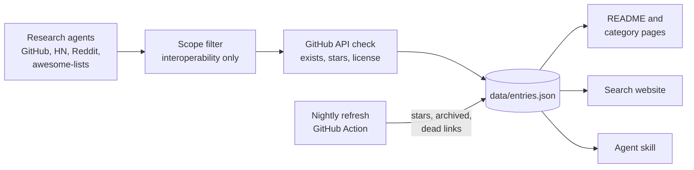

<div align="center">

<a href="https://alexgaoth.github.io/awesome-reverse-engineered/"></a>

<p><a href="README.md">English</a> · <a href="README.zh-CN.md">简体中文</a> · <a href="README.fr.md">Français</a> · <a href="README.es.md">Español</a> · <a href="README.vi.md">Tiếng Việt</a> · <b>Português (BR)</b></p>

## Não faça engenharia reversa duas vezes.

17,734 ferramentas de código aberto que existem porque alguém fez engenharia reversa de um produto fechado: um app, uma API, um dispositivo, um protocolo, um formato de arquivo, um jogo ou uma ferramenta de IA.

**[Buscar no índice](https://alexgaoth.github.io/awesome-reverse-engineered/)** ou entregue ao seu agente: `npx skills add alexgaoth/awesome-reverse-engineered`

[](https://awesome.re) [](#o-que-tem-aqui) [](.github/workflows/refresh.yml) [](https://github.com/alexgaoth/awesome-reverse-engineered/stargazers) [](LICENSE)

**[Skill para agentes](#dê-o-índice-inteiro-ao-seu-agente-de-ia)** · **[Categorias](#o-que-tem-aqui)** · **[Em alta nesta semana](#em-alta-nesta-semana)** · **[Sugerir um projeto](#como-contribuir)**

<a href="https://trendshift.io/repositories/313508"></a>

<sub>Os nomes e as descrições dos projetos estão em inglês.</sub>

</div>

---

## Antes de fazer engenharia reversa de algo

Agentes e ferramentas como [REA](https://github.com/morluto/rea) e [Ghidra](https://github.com/NationalSecurityAgency/ghidra) deixam a engenharia reversa mais rápida do que nunca. Ainda assim, o app, a API, o dispositivo ou o formato de arquivo que você vai abrir muitas vezes já foi resolvido, e o trabalho está num repo que ninguém linka.

1. **Busque primeiro.** Use o [site](https://alexgaoth.github.io/awesome-reverse-engineered/) ou a [skill para agentes](#dê-o-índice-inteiro-ao-seu-agente-de-ia). Busque por produto, fabricante ou protocolo.
2. **Achou?** Use, corrija e reporte os problemas no projeto original. Um cliente mantido vale mais que dez scripts particulares.
3. **Não está aqui?** Faça o trabalho, publique como código aberto e [adicione aqui](#como-contribuir) para que a próxima pessoa comece de onde você parou.

## O que tem aqui

**17,734 projetos** que somam **12.3 mi** de estrelas no GitHub: 10,119 ativos, 2,498 desacelerando, 3,488 parados, 1,174 arquivados. Principais linguagens: Python (4,031), C++ (2,660), C (2,537), JavaScript (1,062), C# (957).

| Categoria | Projetos | Destaques |
|---|--:|---|
| [**Ferramentas de IA e clientes de LLM**](categories/ai-tools-llm-clients.md) | 755 | [claw-code](https://github.com/ultraworkers/claw-code), [system-prompts-and-models-of-ai-tools](https://github.com/x1xhlol/system-prompts-and-models-of-ai-tools), [system_prompts_leaks](https://github.com/asgeirtj/system_prompts_leaks) |
| [**Decompilações e reimplementações de jogos**](categories/game-decompilations-reimplementations.md) | 6,107 | [shadPS4](https://github.com/shadps4-emu/shadPS4), [v86](https://github.com/copy/v86), [RPCS3](https://github.com/RPCS3/rpcs3) |
| [**Dispositivos, IoT e hardware**](categories/devices-iot-hardware.md) | 3,123 | [KOReader](https://github.com/koreader/koreader), [LibrePods](https://github.com/librepods-org/librepods), [OpenLogi](https://github.com/AprilNEA/OpenLogi) |
| [**Clientes de APIs web e de apps não oficiais**](categories/unofficial-web-app-api-clients.md) | 989 | [yt-dlp](https://github.com/yt-dlp/yt-dlp), [youtube-dl](https://github.com/ytdl-org/youtube-dl), [MediaCrawler](https://github.com/NanmiCoder/MediaCrawler) |
| [**Mensageiros e redes sociais**](categories/messaging-social-apps.md) | 310 | [WeChatMsg](https://github.com/LC044/WeChatMsg), [ItChat](https://github.com/littlecodersh/ItChat), [wechaty](https://github.com/wechaty/wechaty) |
| [**Clientes de terceiros**](categories/third-party-clients.md) | 208 | [spotify-tui](https://github.com/Rigellute/spotify-tui), [nuclear](https://github.com/nukeop/nuclear), [SimpMusic](https://github.com/maxrave-dev/SimpMusic) |
| [**Plataformas chinesas e asiáticas**](categories/chinese-asian-platforms.md) | 779 | [lx-music-desktop](https://github.com/lyswhut/lx-music-desktop), [alist](https://github.com/AlistGo/alist), [RevokeMsgPatcher](https://github.com/huiyadanli/RevokeMsgPatcher) |
| [**Ecossistema Apple**](categories/apple-ecosystem.md) | 347 | [fastlane](https://github.com/fastlane/fastlane), [homebridge](https://github.com/homebridge/homebridge), [OSX-KVM](https://github.com/kholia/OSX-KVM) |
| [**Drivers e hardware de baixo nível**](categories/drivers-low-level-hardware.md) | 442 | [MonitorControl](https://github.com/MonitorControl/MonitorControl), [tinygrad](https://github.com/tinygrad/tinygrad), [G-Helper](https://github.com/seerge/g-helper) |
| [**Automotivo**](categories/automotive.md) | 536 | [openpilot](https://github.com/commaai/openpilot), [evcc](https://github.com/evcc-io/evcc), [VESC firmware](https://github.com/vedderb/bldc) |
| [**Automação industrial e predial**](categories/industrial-building-automation.md) | 292 | [HslCommunication](https://github.com/dathlin/HslCommunication), [plc4x](https://github.com/apache/plc4x), [IoTClient](https://github.com/zhaopeiym/IoTClient) |
| [**Firmware e sistemas embarcados**](categories/firmware-embedded.md) | 538 | [LEDE (Lean)](https://github.com/coolsnowwolf/lede), [OpenWrt](https://github.com/openwrt/openwrt), [Tasmota](https://github.com/arendst/Tasmota) |
| [**Protocolos de rede e de comunicação**](categories/network-wire-protocols.md) | 431 | [Sunshine](https://github.com/LizardByte/Sunshine), [moonlight-qt](https://github.com/moonlight-stream/moonlight-qt), [Impacket](https://github.com/fortra/impacket) |
| [**Formatos de arquivo**](categories/file-formats.md) | 444 | [FFmpeg](https://github.com/FFmpeg/FFmpeg), [ImHex](https://github.com/WerWolv/ImHex), [SheetJS](https://github.com/SheetJS/sheetjs) |
| [**Serviços online ressuscitados**](categories/online-service-revivals.md) | 638 | [NoLongerEvil Thermostat](https://github.com/codykociemba/NoLongerEvil-Thermostat), [Legacy Update](https://github.com/LegacyUpdate/LegacyUpdate), [DeskThing](https://github.com/ItsRiprod/DeskThing) |
| [**Reimplementações de software desktop**](categories/desktop-software-reimplementations.md) | 237 | [PhotoCraft](https://github.com/storytold/photocraft), [vaultwarden](https://github.com/dani-garcia/vaultwarden), [Proton](https://github.com/ValveSoftware/Proton) |
| [**Frontends alternativos**](categories/alternative-frontends.md) | 122 | [searxng](https://github.com/searxng/searxng), [searx](https://github.com/searx/searx), [Whoogle Search](https://github.com/benbusby/whoogle-search) |
| [**Apps móveis**](categories/mobile-apps.md) | 113 | [revanced-manager](https://github.com/ReVanced/revanced-manager), [Metrolist](https://github.com/MetrolistGroup/Metrolist), [LibreTube](https://github.com/libre-tube/LibreTube) |
| [**Ferramentas de engenharia reversa**](categories/re-tooling.md) | 1,174 | [rea](https://github.com/morluto/rea), [Ghidra](https://github.com/NationalSecurityAgency/ghidra), [jadx](https://github.com/skylot/jadx) |
| [**Coleções e listas Awesome**](categories/collections-awesome-lists.md) | 149 | [Corkami pics](https://github.com/corkami/pics), [awesome reverse-engineering (wtsxDev)](https://github.com/wtsxDev/reverse-engineering), [android-security-awesome](https://github.com/ashishb/android-security-awesome) |

## Ressuscitados

129 produtos que o fabricante matou, mantidos vivos por projetos de código aberto feitos com engenharia reversa.

| Produto | Encerrado por | Ano | Revivido por |
|---|---|--:|---|
| Spotify Car Thing | Spotify | 2024 | [DeskThing](https://github.com/ItsRiprod/DeskThing) |
| Amazon Dash Button | Amazon | 2019 | [node-dash-button](https://github.com/hortinstein/node-dash-button) |
| Nest Learning Thermostat (1st and 2nd gen) | Google | 2025 | [NoLongerEvil Thermostat](https://github.com/codykociemba/NoLongerEvil-Thermostat) |
| AOL Instant Messenger (AIM) | AOL | 2017 | [Open OSCAR Server (Retro AIM Server)](https://github.com/mk6i/open-oscar-server) |
| Nintendo Wi-Fi Connection (DS and Wii online) | Nintendo | 2014 | [DWC Network Server Emulator](https://github.com/barronwaffles/dwc_network_server_emulator) |
| ICQ | VK | 2024 | [Open OSCAR Server (Retro AIM Server)](https://github.com/mk6i/open-oscar-server) |
| Pebble smartwatch | Fitbit | 2018 | [mobile-app](https://github.com/pebble-dev/mobile-app) |
| Neato robot vacuums | Neato Robotics / Vorwerk | 2025 | [fang](https://github.com/vacuula/fang) |

**[Veja os 129 na página Ressuscitados →](https://alexgaoth.github.io/awesome-reverse-engineered/resurrected/)**

## Dê o índice inteiro ao seu agente de IA

Quando uma tarefa precisa conversar com algo sem API oficial (uma tomada inteligente, um carro, um app de mensagens, um formato de arquivo), seu agente busca neste índice, ordena por estrelas, atividade e licença, lê o README e escolhe a ferramenta certa.

```bash
npx skills add alexgaoth/awesome-reverse-engineered
```

<details><summary><b>Outras formas de instalar</b></summary>

**Plugin do Claude Code**

```
/plugin install reverse-engineered --marketplace alexgaoth/awesome-reverse-engineered
```

**Servidor MCP (Claude Desktop, Cursor, qualquer cliente MCP)**

```bash
claude mcp add reverse-engineered -- uvx --from "git+https://github.com/alexgaoth/awesome-reverse-engineered#subdirectory=mcp" reverse-engineered-mcp
```

```json
{"mcpServers": {"reverse-engineered": {"command": "uvx", "args": ["--from", "git+https://github.com/alexgaoth/awesome-reverse-engineered#subdirectory=mcp", "reverse-engineered-mcp"]}}}
```

**Qualquer agente ou terminal (um único arquivo, só a biblioteca padrão do Python)**

```bash
curl -sL https://raw.githubusercontent.com/alexgaoth/awesome-reverse-engineered/main/plugin/skills/find-reverse-engineered/scripts/re_index.py -o re_index.py
python3 re_index.py search tuya local          # ranked matches
python3 re_index.py info make-all/tuya-local   # entry + README excerpt
python3 re_index.py clone make-all/tuya-local  # shallow clone into vendor/
```

</details>

<p align="center"></p>
<p align="center"><sub>Saída real da skill com os dados atuais.</sub></p>

## Busque na web

Filtre 17,734 projetos por categoria, linguagem e saúde, ordenados por estrelas ou atividade recente. Toda busca tem um link para compartilhar.

<p align="center"><a href="https://alexgaoth.github.io/awesome-reverse-engineered/"></a></p>

<p align="center"><a href="https://alexgaoth.github.io/awesome-reverse-engineered/"><b>Abrir a busca →</b></a></p>

## Em alta nesta semana

Os projetos com mais estrelas que receberam commits nos últimos 7 dias.

| Projeto | O que faz | ★ | Saúde | Linguagem |
|---|---|--:|:-:|---|
| [rea](https://github.com/morluto/rea) | Agentic tool to reverse engineer apps from behavior down to native binaries | 413,997 | 🟢 | TypeScript |
| [yt-dlp](https://github.com/yt-dlp/yt-dlp) | A feature-rich command-line audio/video downloader | 204,104 | 🟢 | Python |
| [claw-code](https://github.com/ultraworkers/claw-code) | Clean-room Rust/Python rewrite of the Claude Code agent harness after the source leak | 194,994 | 🟢 | Rust |
| [youtube-dl](https://github.com/ytdl-org/youtube-dl) | Command-line program to download videos from YouTube.com and other video sites | 141,437 | 🟢 | Python |
| [Ghidra](https://github.com/NationalSecurityAgency/ghidra) | NSA's software reverse engineering framework with decompiler | 96,341 | 🟢 | Java |
| [PhotoCraft](https://github.com/storytold/photocraft) | Clean-room Photoshop-style photo editor written from scratch in pure Rust | 75,386 | 🟢 | Rust |
| [system_prompts_leaks](https://github.com/asgeirtj/system_prompts_leaks) | Archive of extracted system prompts from ChatGPT, Claude, Gemini, Grok and others, per vendor with history | 70,511 | 🟢 | Python |
| [vaultwarden](https://github.com/dani-garcia/vaultwarden) | Unofficial Bitwarden-compatible server written in Rust | 69,979 | 🟢 | Rust |
| [MediaCrawler](https://github.com/NanmiCoder/MediaCrawler) | Crawler for Xiaohongshu, Douyin, Kuaishou, Bilibili and Weibo posts and comments | 69,077 | 🟢 | Python |
| [gpt4free](https://github.com/xtekky/gpt4free) | Reverse-engineered third-party provider APIs giving free access to GPT-4 and other LLMs | 66,961 | 🟢 | Python |

## Adicionados recentemente

| Projeto | O que faz | ★ | Saúde | Linguagem |
|---|---|--:|:-:|---|
| [RSSHub](https://github.com/DIYgod/RSSHub) | RSS feed generator that scrapes hundreds of sites and apps, many via unofficial APIs | 46,739 | 🟢 | TypeScript |
| [RevokeMsgPatcher](https://github.com/huiyadanli/RevokeMsgPatcher) | Binary patcher that blocks message recall in desktop WeChat, QQ and TIM | 39,072 | 🟢 | C# |
| [lux](https://github.com/iawia002/lux) | Go video download library and CLI for Bilibili, Douyin, YouTube and many other sites | 31,813 | 🟢 | Go |
| [res-downloader](https://github.com/putyy/res-downloader) | Proxy-based downloader for WeChat Channels, mini programs, Douyin, Kuaishou and Xiaohongshu media | 21,002 | 🟢 | Go |
| [AlgerMusicPlayer](https://github.com/algerkong/AlgerMusicPlayer) | Third-party desktop music player built on the NetEase Cloud Music API | 17,148 | 🟢 | Vue |
| [wechat-article-exporter](https://github.com/wechat-article/wechat-article-exporter) | Online batch exporter for WeChat Official Account articles with read and comment data | 13,118 | 🟢 | TypeScript |
| [douyin-downloader](https://github.com/jiji262/douyin-downloader) | Douyin video downloader for single posts and whole profiles | 12,503 | 🟢 | Python |
| [MiGPT](https://github.com/idootop/mi-gpt) | Connects Xiaomi XiaoAI smart speakers to ChatGPT and Doubao via the Mi cloud API | 12,495 | 🗄️ | TypeScript |
| [wx_channels_download](https://github.com/ltaoo/wx_channels_download) | Downloader for WeChat Channels (Shipinhao) videos | 10,275 | 🟢 | Go |
| [musicbox](https://github.com/darknessomi/musicbox) | Command-line client for NetEase Cloud Music | 9,867 | 🟢 | Python |
| [wewe-rss](https://github.com/cooderl/wewe-rss) | Self-hosted RSS feeds for WeChat Official Accounts via the WeChat Read API | 9,633 | 🗄️ | TypeScript |
| [Bili23-Downloader](https://github.com/ScottSloan/Bili23-Downloader) | Cross-platform Bilibili video downloader with danmaku and metadata support | 8,780 | 🟢 | Python |
| [ieaseMusic](https://github.com/trazyn/ieaseMusic) | Third-party desktop client for NetEase Cloud Music (Electron) | 8,738 | 🗄️ | JavaScript |
| [LAMDA](https://github.com/firerpa/lamda) | Android device control platform with remote desktop, automation, MITM and built-in Frida | 8,695 | 🟢 | Python |
| [bypy](https://github.com/houtianze/bypy) | Python command-line client for Baidu Netdisk (Baidu Yun) | 8,587 | 🟡 | Python |

## Mais estrelados

| # | Projeto | O que faz | ★ | Saúde | Linguagem |
|--:|---|---|--:|:-:|---|
| 1 | [rea](https://github.com/morluto/rea) | Agentic tool to reverse engineer apps from behavior down to native binaries | 413,997 | 🟢 | TypeScript |
| 2 | [yt-dlp](https://github.com/yt-dlp/yt-dlp) | A feature-rich command-line audio/video downloader | 204,104 | 🟢 | Python |
| 3 | [claw-code](https://github.com/ultraworkers/claw-code) | Clean-room Rust/Python rewrite of the Claude Code agent harness after the source leak | 194,994 | 🟢 | Rust |
| 4 | [system-prompts-and-models-of-ai-tools](https://github.com/x1xhlol/system-prompts-and-models-of-ai-tools) | Extracted system prompts and tool definitions for Cursor, Claude Code, Devin, Windsurf, Kiro, v0, Lovable and more | 144,375 | 🟢 |  |
| 5 | [youtube-dl](https://github.com/ytdl-org/youtube-dl) | Command-line program to download videos from YouTube.com and other video sites | 141,437 | 🟢 | Python |
| 6 | [Ghidra](https://github.com/NationalSecurityAgency/ghidra) | NSA's software reverse engineering framework with decompiler | 96,341 | 🟢 | Java |
| 7 | [PhotoCraft](https://github.com/storytold/photocraft) | Clean-room Photoshop-style photo editor written from scratch in pure Rust | 75,386 | 🟢 | Rust |
| 8 | [system_prompts_leaks](https://github.com/asgeirtj/system_prompts_leaks) | Archive of extracted system prompts from ChatGPT, Claude, Gemini, Grok and others, per vendor with history | 70,511 | 🟢 | Python |
| 9 | [vaultwarden](https://github.com/dani-garcia/vaultwarden) | Unofficial Bitwarden-compatible server written in Rust | 69,979 | 🟢 | Rust |
| 10 | [MediaCrawler](https://github.com/NanmiCoder/MediaCrawler) | Crawler for Xiaohongshu, Douyin, Kuaishou, Bilibili and Weibo posts and comments | 69,077 | 🟢 | Python |
| 11 | [gpt4free](https://github.com/xtekky/gpt4free) | Reverse-engineered third-party provider APIs giving free access to GPT-4 and other LLMs | 66,961 | 🟢 | Python |
| 12 | [FFmpeg](https://github.com/FFmpeg/FFmpeg) | Multimedia framework with many reverse-engineered proprietary codecs and containers | 66,129 | 🟢 | C |
| 13 | [openpilot](https://github.com/commaai/openpilot) | Open-source driver assistance system for 300+ car models | 64,031 | 🟢 | Python |
| 14 | [CLIProxyAPI](https://github.com/router-for-me/CLIProxyAPI) | Wraps Codex, Claude Code, Antigravity, Grok and Gemini CLI OAuth backends as OpenAI/Claude-compatible APIs | 57,091 | 🟢 | Go |
| 15 | [ImHex](https://github.com/WerWolv/ImHex) | Hex editor for reverse engineers with a pattern language for binary formats | 55,674 | 🟢 | C++ |
| 16 | [lx-music-desktop](https://github.com/lyswhut/lx-music-desktop) | LX Music: desktop music player aggregating Chinese music platform sources | 54,934 | 🟢 | TypeScript |
| 17 | [CL4R1T4S](https://github.com/elder-plinius/CL4R1T4S) | Leaked system prompts and tool specs for ChatGPT, Claude, Gemini, Grok, Perplexity, Cursor, Lovable, Replit and others | 51,647 | 🟢 |  |
| 18 | [jadx](https://github.com/skylot/jadx) | Dex to Java decompiler for Android apps | 51,405 | 🟢 | Java |
| 19 | [Spotube](https://github.com/team-spotube/spotube) | Cross-platform Spotify client that streams audio from other sources | 50,508 | 🟢 | Kotlin |
| 20 | [alist](https://github.com/AlistGo/alist) | AList: file list and WebDAV server that mounts many cloud drives through their private APIs | 50,385 | 🟢 | Go |
| 21 | [x64dbg](https://github.com/x64dbg/x64dbg) | Open source user-mode debugger for Windows | 50,084 | 🟢 | C++ |
| 22 | [RSSHub](https://github.com/DIYgod/RSSHub) | RSS feed generator that scrapes hundreds of sites and apps, many via unofficial APIs | 46,739 | 🟢 | TypeScript |
| 23 | [mitmproxy](https://github.com/mitmproxy/mitmproxy) | Interactive TLS-capable intercepting HTTP proxy | 46,511 | 🟢 | Python |
| 24 | [sub2api](https://github.com/Wei-Shaw/sub2api) | Relay that exposes Claude, OpenAI, Gemini and Grok subscriptions as unified APIs | 45,198 | 🟢 | Go |
| 25 | [Sunshine](https://github.com/LizardByte/Sunshine) | Self-hosted game stream host that implements the NVIDIA GameStream protocol for Moonlight clients | 42,828 | 🟢 | C++ |

## Saúde

| | Significado |
|:-:|---|
| 🟢 | Ativo: push nos últimos 12 meses |
| 🟡 | Desacelerando: último push há 1 a 3 anos |
| 🔴 | Parado: sem push há mais de 3 anos |
| 🗄️ | Arquivado pelo dono |
| ⚪ | Desconhecido: não hospedado no GitHub |

APIs não oficiais quebram quando o fabricante muda algo do lado dele. Confira a saúde de um projeto antes de depender dele.

## Como é feito



Dados brutos: [`data/entries.json`](data/entries.json). Repos removidos: [`data/removed.json`](data/removed.json). Listas importadas e buscas: [SOURCES.md](SOURCES.md).

### Como filtramos

| | |
|--:|---|
| 3,420 | buscas no GitHub, Hacker News, Reddit e na web |
| 351 | listas e coleções existentes importadas |
| 202 | repos descartados pelo filtro de escopo (exploits, jailbreaks, burlas de segurança, DRM, cheats). Os agentes de pesquisa também os descartam antes desta etapa. |
| 17,734 | repos no índice, cada um verificado pela API do GitHub (existência, URL canônica, estrelas, licença) |
| 1,174 | arquivados pelos donos: mantidos e marcados com 🗄️ |
| 76 | removidos pela verificação noturna porque o repo foi apagado ou ficou privado ([lista](data/removed.json)) |

<p align="center"></p>

## Escopo

Este índice reúne projetos de **interoperabilidade, preservação e pesquisa**: clientes e SDKs não oficiais, drivers abertos, bibliotecas de controle local, leitores de formatos de arquivo, documentação de protocolos, reimplementações e decompilações. A engenharia reversa para fins de interoperabilidade é protegida em muitos lugares (por exemplo, 17 U.S.C. §1201(f) e o artigo 6 da Diretiva Europeia de Software).

**Deixado de fora de propósito:** exploits e jailbreaks, burla de segurança ou de certificate pinning, ferramentas de descriptografia, cheats, remoção de DRM ou paywall, resolvedores de CAPTCHA, bots de contas e ferramentas de credenciais.

Usar um cliente não oficial pode violar os termos de uso de um serviço. Use estes projetos com suas próprias contas, dispositivos e dados.

## Como contribuir

Conhece um projeto que deveria estar aqui? [Abra uma issue](https://github.com/alexgaoth/awesome-reverse-engineered/issues/new?title=Add%3A%20&body=Repo%3A%20%0AWhat%20it%20reverse%20engineers%3A%20) com o link do repo e uma linha dizendo de que produto ele faz engenharia reversa, ou envie um PR que o adicione a `data/entries.json`. Categoria errada, link quebrado ou fora do escopo? Abra uma issue também.

Curadoria de [@alexgaoth](https://github.com/alexgaoth) com agentes de pesquisa. Cada entrada é verificada pela API do GitHub.

## Seu projeto está na lista?

[](https://github.com/alexgaoth/awesome-reverse-engineered)

Adicione este selo ao seu README. No [site](https://alexgaoth.github.io/awesome-reverse-engineered/), cada projeto tem um botão **badge** que copia uma versão com link para a própria entrada.

```markdown
[](https://github.com/alexgaoth/awesome-reverse-engineered)
```

## Histórico de estrelas

<a href="https://star-history.com/#alexgaoth/awesome-reverse-engineered&Date"></a>

## Licença

Código (scripts, site, skill para agentes): [MIT](LICENSE). Lista e dados: [CC0 1.0](LICENSE-DATA). Cada projeto listado tem sua própria licença.

<div align="center">

**Se isso te poupou de fazer engenharia reversa por conta própria, [deixe uma estrela](https://github.com/alexgaoth/awesome-reverse-engineered).**

</div>
