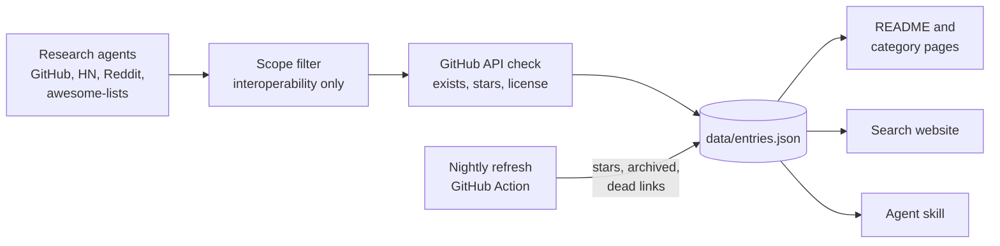

<div align="center">

<a href="https://alexgaoth.github.io/awesome-reverse-engineered/"></a>

<p><a href="README.md">English</a> · <a href="README.zh-CN.md">简体中文</a> · <a href="README.fr.md">Français</a> · <a href="README.es.md">Español</a> · <b>Tiếng Việt</b> · <a href="README.pt-BR.md">Português (BR)</a></p>

## Đừng dịch ngược cùng một thứ hai lần.

17,736 công cụ mã nguồn mở ra đời vì có người đã dịch ngược một ứng dụng, API, thiết bị, giao thức, định dạng tệp, trò chơi hoặc sản phẩm AI đóng.

**[Tìm trong chỉ mục](https://alexgaoth.github.io/awesome-reverse-engineered/)** hoặc giao cho agent của bạn: `npx skills add alexgaoth/awesome-reverse-engineered`

[](https://awesome.re) [](#có-gì-bên-trong) [](.github/workflows/refresh.yml) [](https://github.com/alexgaoth/awesome-reverse-engineered/stargazers) [](LICENSE)

**[Skill cho agent](#trao-toàn-bộ-chỉ-mục-cho-ai-agent-của-bạn)** · **[Danh mục](#có-gì-bên-trong)** · **[Nổi bật tuần này](#nổi-bật-tuần-này)** · **[Đề xuất dự án](#đóng-góp)**

<a href="https://trendshift.io/repositories/313508"></a>

<sub>Tên và mô tả dự án được giữ nguyên bằng tiếng Anh.</sub>

</div>

---

## Trước khi bạn dịch ngược một thứ gì đó

Agent và các công cụ như [REA](https://github.com/morluto/rea) và [Ghidra](https://github.com/NationalSecurityAgency/ghidra) giúp việc dịch ngược nhanh hơn bao giờ hết. Dù vậy, ứng dụng, API, thiết bị hay định dạng tệp bạn sắp mổ xẻ thường đã có người làm rồi, và kết quả nằm trong một repo chẳng ai liên kết tới.

1. **Tìm trước.** Dùng [website](https://alexgaoth.github.io/awesome-reverse-engineered/) hoặc [skill cho agent](#trao-toàn-bộ-chỉ-mục-cho-ai-agent-của-bạn). Tìm theo sản phẩm, hãng hoặc giao thức.
2. **Tìm thấy rồi?** Dùng nó, sửa nó và báo lỗi cho dự án gốc. Một client được bảo trì tốt hơn mười script riêng lẻ.
3. **Chưa có?** Tự làm, công bố dưới dạng mã nguồn mở, rồi [thêm vào đây](#đóng-góp) để người sau bắt đầu từ chỗ bạn dừng lại.

## Có gì bên trong

**17,736 dự án** với tổng cộng **12.3M** sao GitHub: 10,121 đang hoạt động, 2,498 chậm lại, 3,488 ngừng phát triển, 1,174 đã lưu trữ. Ngôn ngữ phổ biến: Python (4,030), C++ (2,661), C (2,539), JavaScript (1,062), C# (957).

| Danh mục | Dự án | Tiêu biểu |
|---|--:|---|
| [**Công cụ AI và client LLM**](categories/ai-tools-llm-clients.md) | 755 | [claw-code](https://github.com/ultraworkers/claw-code), [system-prompts-and-models-of-ai-tools](https://github.com/x1xhlol/system-prompts-and-models-of-ai-tools), [system_prompts_leaks](https://github.com/asgeirtj/system_prompts_leaks) |
| [**Dịch ngược và tái hiện trò chơi**](categories/game-decompilations-reimplementations.md) | 6,107 | [shadPS4](https://github.com/shadps4-emu/shadPS4), [v86](https://github.com/copy/v86), [RPCS3](https://github.com/RPCS3/rpcs3) |
| [**Thiết bị, IoT và phần cứng**](categories/devices-iot-hardware.md) | 3,123 | [KOReader](https://github.com/koreader/koreader), [LibrePods](https://github.com/librepods-org/librepods), [OpenLogi](https://github.com/AprilNEA/OpenLogi) |
| [**Client API web/ứng dụng không chính thức**](categories/unofficial-web-app-api-clients.md) | 989 | [yt-dlp](https://github.com/yt-dlp/yt-dlp), [youtube-dl](https://github.com/ytdl-org/youtube-dl), [MediaCrawler](https://github.com/NanmiCoder/MediaCrawler) |
| [**Ứng dụng nhắn tin và mạng xã hội**](categories/messaging-social-apps.md) | 310 | [WeChatMsg](https://github.com/LC044/WeChatMsg), [ItChat](https://github.com/littlecodersh/ItChat), [wechaty](https://github.com/wechaty/wechaty) |
| [**Client bên thứ ba**](categories/third-party-clients.md) | 208 | [spotify-tui](https://github.com/Rigellute/spotify-tui), [nuclear](https://github.com/nukeop/nuclear), [SimpMusic](https://github.com/maxrave-dev/SimpMusic) |
| [**Nền tảng Trung Quốc và châu Á**](categories/chinese-asian-platforms.md) | 779 | [lx-music-desktop](https://github.com/lyswhut/lx-music-desktop), [alist](https://github.com/AlistGo/alist), [RevokeMsgPatcher](https://github.com/huiyadanli/RevokeMsgPatcher) |
| [**Hệ sinh thái Apple**](categories/apple-ecosystem.md) | 347 | [fastlane](https://github.com/fastlane/fastlane), [homebridge](https://github.com/homebridge/homebridge), [OSX-KVM](https://github.com/kholia/OSX-KVM) |
| [**Driver và phần cứng cấp thấp**](categories/drivers-low-level-hardware.md) | 443 | [MonitorControl](https://github.com/MonitorControl/MonitorControl), [tinygrad](https://github.com/tinygrad/tinygrad), [G-Helper](https://github.com/seerge/g-helper) |
| [**Ô tô**](categories/automotive.md) | 536 | [openpilot](https://github.com/commaai/openpilot), [evcc](https://github.com/evcc-io/evcc), [VESC firmware](https://github.com/vedderb/bldc) |
| [**Tự động hóa công nghiệp và tòa nhà**](categories/industrial-building-automation.md) | 292 | [HslCommunication](https://github.com/dathlin/HslCommunication), [plc4x](https://github.com/apache/plc4x), [IoTClient](https://github.com/zhaopeiym/IoTClient) |
| [**Firmware và hệ thống nhúng**](categories/firmware-embedded.md) | 538 | [LEDE (Lean)](https://github.com/coolsnowwolf/lede), [OpenWrt](https://github.com/openwrt/openwrt), [Tasmota](https://github.com/arendst/Tasmota) |
| [**Giao thức mạng và truyền dẫn**](categories/network-wire-protocols.md) | 431 | [Sunshine](https://github.com/LizardByte/Sunshine), [moonlight-qt](https://github.com/moonlight-stream/moonlight-qt), [Impacket](https://github.com/fortra/impacket) |
| [**Định dạng tệp**](categories/file-formats.md) | 444 | [FFmpeg](https://github.com/FFmpeg/FFmpeg), [ImHex](https://github.com/WerWolv/ImHex), [SheetJS](https://github.com/SheetJS/sheetjs) |
| [**Hồi sinh dịch vụ trực tuyến**](categories/online-service-revivals.md) | 638 | [NoLongerEvil Thermostat](https://github.com/codykociemba/NoLongerEvil-Thermostat), [Legacy Update](https://github.com/LegacyUpdate/LegacyUpdate), [DeskThing](https://github.com/ItsRiprod/DeskThing) |
| [**Tái hiện phần mềm máy tính**](categories/desktop-software-reimplementations.md) | 237 | [PhotoCraft](https://github.com/storytold/photocraft), [vaultwarden](https://github.com/dani-garcia/vaultwarden), [Proton](https://github.com/ValveSoftware/Proton) |
| [**Frontend thay thế**](categories/alternative-frontends.md) | 122 | [searxng](https://github.com/searxng/searxng), [searx](https://github.com/searx/searx), [Whoogle Search](https://github.com/benbusby/whoogle-search) |
| [**Ứng dụng di động**](categories/mobile-apps.md) | 113 | [revanced-manager](https://github.com/ReVanced/revanced-manager), [Metrolist](https://github.com/MetrolistGroup/Metrolist), [LibreTube](https://github.com/libre-tube/LibreTube) |
| [**Công cụ dịch ngược**](categories/re-tooling.md) | 1,175 | [rea](https://github.com/morluto/rea), [Ghidra](https://github.com/NationalSecurityAgency/ghidra), [jadx](https://github.com/skylot/jadx) |
| [**Bộ sưu tập và danh sách Awesome**](categories/collections-awesome-lists.md) | 149 | [Corkami pics](https://github.com/corkami/pics), [awesome reverse-engineering (wtsxDev)](https://github.com/wtsxDev/reverse-engineering), [android-security-awesome](https://github.com/ashishb/android-security-awesome) |

## Hồi sinh

129 sản phẩm bị chính hãng khai tử, được các dự án mã nguồn mở xây dựng nhờ dịch ngược giữ cho tiếp tục hoạt động.

| Sản phẩm | Bị khai tử bởi | Năm | Hồi sinh bởi |
|---|---|--:|---|
| Spotify Car Thing | Spotify | 2024 | [DeskThing](https://github.com/ItsRiprod/DeskThing) |
| Amazon Dash Button | Amazon | 2019 | [node-dash-button](https://github.com/hortinstein/node-dash-button) |
| Nest Learning Thermostat (1st and 2nd gen) | Google | 2025 | [NoLongerEvil Thermostat](https://github.com/codykociemba/NoLongerEvil-Thermostat) |
| AOL Instant Messenger (AIM) | AOL | 2017 | [Open OSCAR Server (Retro AIM Server)](https://github.com/mk6i/open-oscar-server) |
| Nintendo Wi-Fi Connection (DS and Wii online) | Nintendo | 2014 | [DWC Network Server Emulator](https://github.com/barronwaffles/dwc_network_server_emulator) |
| ICQ | VK | 2024 | [Open OSCAR Server (Retro AIM Server)](https://github.com/mk6i/open-oscar-server) |
| Pebble smartwatch | Fitbit | 2018 | [mobile-app](https://github.com/pebble-dev/mobile-app) |
| Neato robot vacuums | Neato Robotics / Vorwerk | 2025 | [fang](https://github.com/vacuula/fang) |

**[Xem cả 129 sản phẩm trên trang Hồi sinh →](https://alexgaoth.github.io/awesome-reverse-engineered/resurrected/)**

## Trao toàn bộ chỉ mục cho AI agent của bạn

Khi một tác vụ cần làm việc với thứ không có API chính thức (ổ cắm thông minh, ô tô, ứng dụng nhắn tin, định dạng tệp), agent của bạn sẽ tìm trong chỉ mục này, xếp hạng theo số sao, mức độ hoạt động và giấy phép, đọc README rồi chọn công cụ phù hợp.

```bash
npx skills add alexgaoth/awesome-reverse-engineered
```

<details><summary><b>Các cách cài đặt khác</b></summary>

**Plugin Claude Code**

```
/plugin install reverse-engineered --marketplace alexgaoth/awesome-reverse-engineered
```

**Máy chủ MCP (Claude Desktop, Cursor, mọi client MCP)**

```bash
claude mcp add reverse-engineered -- uvx --from "git+https://github.com/alexgaoth/awesome-reverse-engineered#subdirectory=mcp" reverse-engineered-mcp
```

```json
{"mcpServers": {"reverse-engineered": {"command": "uvx", "args": ["--from", "git+https://github.com/alexgaoth/awesome-reverse-engineered#subdirectory=mcp", "reverse-engineered-mcp"]}}}
```

**Mọi agent hoặc terminal (một tệp, chỉ dùng thư viện chuẩn của Python)**

```bash
curl -sL https://raw.githubusercontent.com/alexgaoth/awesome-reverse-engineered/main/plugin/skills/find-reverse-engineered/scripts/re_index.py -o re_index.py
python3 re_index.py search tuya local          # ranked matches
python3 re_index.py info make-all/tuya-local   # entry + README excerpt
python3 re_index.py clone make-all/tuya-local  # shallow clone into vendor/
```

</details>

<p align="center"></p>
<p align="center"><sub>Kết quả thật của skill trên dữ liệu hiện tại.</sub></p>

## Tìm kiếm trên web

Lọc 17,736 dự án theo danh mục, ngôn ngữ và tình trạng, sắp xếp theo số sao hoặc hoạt động gần đây. Mỗi lượt tìm kiếm đều có liên kết để chia sẻ.

<p align="center"><a href="https://alexgaoth.github.io/awesome-reverse-engineered/"></a></p>

<p align="center"><a href="https://alexgaoth.github.io/awesome-reverse-engineered/"><b>Mở trang tìm kiếm →</b></a></p>

## Nổi bật tuần này

Các dự án nhiều sao nhất có commit trong 7 ngày qua.

| Dự án | Chức năng | ★ | Tình trạng | Ngôn ngữ |
|---|---|--:|:-:|---|
| [rea](https://github.com/morluto/rea) | Agentic tool to reverse engineer apps from behavior down to native binaries | 410,471 | 🟢 | TypeScript |
| [yt-dlp](https://github.com/yt-dlp/yt-dlp) | A feature-rich command-line audio/video downloader | 203,863 | 🟢 | Python |
| [claw-code](https://github.com/ultraworkers/claw-code) | Clean-room Rust/Python rewrite of the Claude Code agent harness after the source leak | 194,976 | 🟢 | Rust |
| [Ghidra](https://github.com/NationalSecurityAgency/ghidra) | NSA's software reverse engineering framework with decompiler | 96,059 | 🟢 | Java |
| [PhotoCraft](https://github.com/storytold/photocraft) | Clean-room Photoshop-style photo editor written from scratch in pure Rust | 75,045 | 🟢 | Rust |
| [system_prompts_leaks](https://github.com/asgeirtj/system_prompts_leaks) | Archive of extracted system prompts from ChatGPT, Claude, Gemini, Grok and others, per vendor with history | 70,462 | 🟢 | Python |
| [vaultwarden](https://github.com/dani-garcia/vaultwarden) | Unofficial Bitwarden-compatible server written in Rust | 69,936 | 🟢 | Rust |
| [MediaCrawler](https://github.com/NanmiCoder/MediaCrawler) | Crawler for Xiaohongshu, Douyin, Kuaishou, Bilibili and Weibo posts and comments | 68,973 | 🟢 | Python |
| [gpt4free](https://github.com/xtekky/gpt4free) | Reverse-engineered third-party provider APIs giving free access to GPT-4 and other LLMs | 66,954 | 🟢 | Python |
| [FFmpeg](https://github.com/FFmpeg/FFmpeg) | Multimedia framework with many reverse-engineered proprietary codecs and containers | 66,067 | 🟢 | C |

## Mới thêm

| Dự án | Chức năng | ★ | Tình trạng | Ngôn ngữ |
|---|---|--:|:-:|---|
| [RSSHub](https://github.com/DIYgod/RSSHub) | RSS feed generator that scrapes hundreds of sites and apps, many via unofficial APIs | 46,731 | 🟢 | TypeScript |
| [RevokeMsgPatcher](https://github.com/huiyadanli/RevokeMsgPatcher) | Binary patcher that blocks message recall in desktop WeChat, QQ and TIM | 39,069 | 🟢 | C# |
| [lux](https://github.com/iawia002/lux) | Go video download library and CLI for Bilibili, Douyin, YouTube and many other sites | 31,816 | 🟢 | Go |
| [res-downloader](https://github.com/putyy/res-downloader) | Proxy-based downloader for WeChat Channels, mini programs, Douyin, Kuaishou and Xiaohongshu media | 20,979 | 🟢 | Go |
| [AlgerMusicPlayer](https://github.com/algerkong/AlgerMusicPlayer) | Third-party desktop music player built on the NetEase Cloud Music API | 17,142 | 🟢 | Vue |
| [wechat-article-exporter](https://github.com/wechat-article/wechat-article-exporter) | Online batch exporter for WeChat Official Account articles with read and comment data | 13,116 | 🟢 | TypeScript |
| [douyin-downloader](https://github.com/jiji262/douyin-downloader) | Douyin video downloader for single posts and whole profiles | 12,499 | 🟢 | Python |
| [MiGPT](https://github.com/idootop/mi-gpt) | Connects Xiaomi XiaoAI smart speakers to ChatGPT and Doubao via the Mi cloud API | 12,493 | 🗄️ | TypeScript |
| [wx_channels_download](https://github.com/ltaoo/wx_channels_download) | Downloader for WeChat Channels (Shipinhao) videos | 10,254 | 🟢 | Go |
| [musicbox](https://github.com/darknessomi/musicbox) | Command-line client for NetEase Cloud Music | 9,867 | 🟢 | Python |
| [wewe-rss](https://github.com/cooderl/wewe-rss) | Self-hosted RSS feeds for WeChat Official Accounts via the WeChat Read API | 9,634 | 🗄️ | TypeScript |
| [Bili23-Downloader](https://github.com/ScottSloan/Bili23-Downloader) | Cross-platform Bilibili video downloader with danmaku and metadata support | 8,764 | 🟢 | Python |
| [ieaseMusic](https://github.com/trazyn/ieaseMusic) | Third-party desktop client for NetEase Cloud Music (Electron) | 8,739 | 🗄️ | JavaScript |
| [LAMDA](https://github.com/firerpa/lamda) | Android device control platform with remote desktop, automation, MITM and built-in Frida | 8,691 | 🟢 | Python |
| [bypy](https://github.com/houtianze/bypy) | Python command-line client for Baidu Netdisk (Baidu Yun) | 8,588 | 🟡 | Python |

## Nhiều sao nhất

| # | Dự án | Chức năng | ★ | Tình trạng | Ngôn ngữ |
|--:|---|---|--:|:-:|---|
| 1 | [rea](https://github.com/morluto/rea) | Agentic tool to reverse engineer apps from behavior down to native binaries | 410,471 | 🟢 | TypeScript |
| 2 | [yt-dlp](https://github.com/yt-dlp/yt-dlp) | A feature-rich command-line audio/video downloader | 203,863 | 🟢 | Python |
| 3 | [claw-code](https://github.com/ultraworkers/claw-code) | Clean-room Rust/Python rewrite of the Claude Code agent harness after the source leak | 194,976 | 🟢 | Rust |
| 4 | [system-prompts-and-models-of-ai-tools](https://github.com/x1xhlol/system-prompts-and-models-of-ai-tools) | Extracted system prompts and tool definitions for Cursor, Claude Code, Devin, Windsurf, Kiro, v0, Lovable and more | 144,354 | 🟢 |  |
| 5 | [youtube-dl](https://github.com/ytdl-org/youtube-dl) | Command-line program to download videos from YouTube.com and other video sites | 141,430 | 🟢 | Python |
| 6 | [Ghidra](https://github.com/NationalSecurityAgency/ghidra) | NSA's software reverse engineering framework with decompiler | 96,059 | 🟢 | Java |
| 7 | [PhotoCraft](https://github.com/storytold/photocraft) | Clean-room Photoshop-style photo editor written from scratch in pure Rust | 75,045 | 🟢 | Rust |
| 8 | [system_prompts_leaks](https://github.com/asgeirtj/system_prompts_leaks) | Archive of extracted system prompts from ChatGPT, Claude, Gemini, Grok and others, per vendor with history | 70,462 | 🟢 | Python |
| 9 | [vaultwarden](https://github.com/dani-garcia/vaultwarden) | Unofficial Bitwarden-compatible server written in Rust | 69,936 | 🟢 | Rust |
| 10 | [MediaCrawler](https://github.com/NanmiCoder/MediaCrawler) | Crawler for Xiaohongshu, Douyin, Kuaishou, Bilibili and Weibo posts and comments | 68,973 | 🟢 | Python |
| 11 | [gpt4free](https://github.com/xtekky/gpt4free) | Reverse-engineered third-party provider APIs giving free access to GPT-4 and other LLMs | 66,954 | 🟢 | Python |
| 12 | [FFmpeg](https://github.com/FFmpeg/FFmpeg) | Multimedia framework with many reverse-engineered proprietary codecs and containers | 66,067 | 🟢 | C |
| 13 | [openpilot](https://github.com/commaai/openpilot) | Open-source driver assistance system for 300+ car models | 64,020 | 🟢 | Python |
| 14 | [CLIProxyAPI](https://github.com/router-for-me/CLIProxyAPI) | Wraps Codex, Claude Code, Antigravity, Grok and Gemini CLI OAuth backends as OpenAI/Claude-compatible APIs | 56,997 | 🟢 | Go |
| 15 | [ImHex](https://github.com/WerWolv/ImHex) | Hex editor for reverse engineers with a pattern language for binary formats | 55,666 | 🟢 | C++ |
| 16 | [lx-music-desktop](https://github.com/lyswhut/lx-music-desktop) | LX Music: desktop music player aggregating Chinese music platform sources | 54,906 | 🟢 | TypeScript |
| 17 | [CL4R1T4S](https://github.com/elder-plinius/CL4R1T4S) | Leaked system prompts and tool specs for ChatGPT, Claude, Gemini, Grok, Perplexity, Cursor, Lovable, Replit and others | 51,614 | 🟢 |  |
| 18 | [jadx](https://github.com/skylot/jadx) | Dex to Java decompiler for Android apps | 51,383 | 🟢 | Java |
| 19 | [Spotube](https://github.com/team-spotube/spotube) | Cross-platform Spotify client that streams audio from other sources | 50,478 | 🟢 | Kotlin |
| 20 | [alist](https://github.com/AlistGo/alist) | AList: file list and WebDAV server that mounts many cloud drives through their private APIs | 50,378 | 🟢 | Go |
| 21 | [x64dbg](https://github.com/x64dbg/x64dbg) | Open source user-mode debugger for Windows | 50,077 | 🟢 | C++ |
| 22 | [RSSHub](https://github.com/DIYgod/RSSHub) | RSS feed generator that scrapes hundreds of sites and apps, many via unofficial APIs | 46,731 | 🟢 | TypeScript |
| 23 | [mitmproxy](https://github.com/mitmproxy/mitmproxy) | Interactive TLS-capable intercepting HTTP proxy | 46,490 | 🟢 | Python |
| 24 | [sub2api](https://github.com/Wei-Shaw/sub2api) | Relay that exposes Claude, OpenAI, Gemini and Grok subscriptions as unified APIs | 45,147 | 🟢 | Go |
| 25 | [Sunshine](https://github.com/LizardByte/Sunshine) | Self-hosted game stream host that implements the NVIDIA GameStream protocol for Moonlight clients | 42,798 | 🟢 | C++ |

## Tình trạng

| | Ý nghĩa |
|:-:|---|
| 🟢 | Đang hoạt động: có push trong 12 tháng qua |
| 🟡 | Chậm lại: lần push cuối cách đây 1 đến 3 năm |
| 🔴 | Ngừng phát triển: không có push hơn 3 năm |
| 🗄️ | Đã được chủ sở hữu lưu trữ (archive) |
| ⚪ | Không rõ: không lưu trữ trên GitHub |

API không chính thức sẽ hỏng khi nhà cung cấp thay đổi phía họ, vì vậy hãy xem tình trạng trước khi phụ thuộc vào một dự án.

## Cách xây dựng



Dữ liệu gốc: [`data/entries.json`](data/entries.json). Repo đã gỡ: [`data/removed.json`](data/removed.json). Các danh sách đã nhập và truy vấn tìm kiếm: [SOURCES.md](SOURCES.md).

### Cách chúng tôi lọc

| | |
|--:|---|
| 3,420 | lượt tìm kiếm trên GitHub, Hacker News, Reddit và web |
| 351 | danh sách và bộ sưu tập có sẵn đã được nhập |
| 202 | repo bị bộ lọc phạm vi loại bỏ (exploit, jailbreak, vượt bảo mật, DRM, cheat). Các agent nghiên cứu cũng bỏ qua những repo này từ trước. |
| 17,736 | repo trong chỉ mục, mỗi repo đều được kiểm tra qua GitHub API (tồn tại, URL chuẩn, số sao, giấy phép) |
| 1,174 | đã được chủ sở hữu lưu trữ: vẫn giữ và đánh dấu 🗄️ |
| 74 | bị kiểm tra hằng đêm loại bỏ vì repo đã bị xóa hoặc chuyển sang riêng tư ([danh sách](data/removed.json)) |

<p align="center"></p>

## Phạm vi

Chỉ mục này liệt kê các dự án phục vụ **khả năng tương tác, bảo tồn và nghiên cứu**: client và SDK không chính thức, driver mở, thư viện điều khiển cục bộ, trình đọc định dạng tệp, tài liệu giao thức, bản tái hiện và bản dịch ngược mã (decompilation). Dịch ngược vì mục đích tương tác được pháp luật bảo vệ ở nhiều nơi (ví dụ 17 U.S.C. §1201(f) và Điều 6 của Chỉ thị Phần mềm EU).

**Cố ý không đưa vào:** exploit và jailbreak, công cụ vượt bảo mật hoặc certificate pinning, công cụ giải mã, cheat, gỡ DRM hoặc paywall, công cụ giải CAPTCHA, bot tài khoản và công cụ về thông tin đăng nhập.

Dùng client không chính thức có thể vi phạm điều khoản sử dụng của dịch vụ. Hãy dùng các dự án này với tài khoản, thiết bị và dữ liệu của chính bạn.

## Đóng góp

Biết một dự án nên có ở đây? [Mở issue](https://github.com/alexgaoth/awesome-reverse-engineered/issues/new?title=Add%3A%20&body=Repo%3A%20%0AWhat%20it%20reverse%20engineers%3A%20) kèm liên kết repo và một dòng mô tả nó dịch ngược thứ gì, hoặc gửi PR thêm nó vào `data/entries.json`. Sai danh mục, liên kết hỏng hay ngoài phạm vi? Cũng hãy mở issue.

Được [@alexgaoth](https://github.com/alexgaoth) tuyển chọn cùng các agent nghiên cứu. Mỗi mục đều được kiểm tra qua GitHub API.

## Dự án của bạn có trong danh sách?

[](https://github.com/alexgaoth/awesome-reverse-engineered)

Thêm huy hiệu này vào README của bạn. Trên [website](https://alexgaoth.github.io/awesome-reverse-engineered/), mỗi dự án có nút **badge** để sao chép phiên bản liên kết tới mục của chính dự án đó.

```markdown
[](https://github.com/alexgaoth/awesome-reverse-engineered)
```

## Lịch sử sao

<a href="https://star-history.com/#alexgaoth/awesome-reverse-engineered&Date"></a>

## Giấy phép

Mã nguồn (script, website, skill cho agent): [MIT](LICENSE). Danh sách và dữ liệu: [CC0 1.0](LICENSE-DATA). Mỗi dự án được liên kết có giấy phép riêng.

<div align="center">

**Nếu chỉ mục này giúp bạn khỏi phải tự dịch ngược, [hãy tặng nó một sao](https://github.com/alexgaoth/awesome-reverse-engineered).**

</div>
