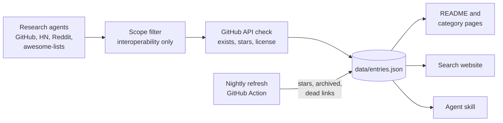

<div align="center">

<a href="https://alexgaoth.github.io/awesome-reverse-engineered/"></a>

<p><a href="README.md">English</a> · <b>简体中文</b> · <a href="README.fr.md">Français</a> · <a href="README.es.md">Español</a></p>

### 12,744 个开源工具，它们之所以存在，是因为有人逆向了某个封闭的应用、API、设备、协议、文件格式、游戏或 AI 产品。

[](https://awesome.re) [](#收录内容) [](#收录内容) [](.github/workflows/refresh.yml) [](data/entries.json) [](LICENSE)

[](#让你的-ai-智能体使用整个索引) [](#让你的-ai-智能体使用整个索引) [](https://github.com/alexgaoth/awesome-reverse-engineered/stargazers)

**[搜索索引](https://alexgaoth.github.io/awesome-reverse-engineered/)** · **[智能体技能](#让你的-ai-智能体使用整个索引)** · **[分类](#收录内容)** · **[本周热门](#本周热门)** · **[提交项目](#参与贡献)**

<sub>项目名称和描述保留英文原文。 · 社区：<a href="https://linux.do">LINUX DO</a></sub>

</div>

---

## 让你的 AI 智能体使用整个索引

当任务需要对接没有官方 API 的东西（智能插座、汽车、聊天应用、文件格式）时，你的智能体会搜索这个索引，按星标数、活跃度和许可证排序，阅读 README，然后挑选合适的工具。

```bash
npx skills add alexgaoth/awesome-reverse-engineered
```

<details><summary><b>其他安装方式</b></summary>

**Claude Code 插件**

```
/plugin install reverse-engineered --marketplace alexgaoth/awesome-reverse-engineered
```

**任意智能体或终端（单个文件，仅依赖 Python 标准库）**

```bash
curl -sL https://raw.githubusercontent.com/alexgaoth/awesome-reverse-engineered/main/plugin/skills/find-reverse-engineered/scripts/re_index.py -o re_index.py
python3 re_index.py search tuya local          # ranked matches
python3 re_index.py info make-all/tuya-local   # entry + README excerpt
python3 re_index.py clone make-all/tuya-local  # shallow clone into vendor/
```

</details>

<p align="center"></p>
<p align="center"><sub>该技能在当前数据上的真实输出。</sub></p>

## 在网页上搜索

按分类、语言和健康状态筛选 12,744 个项目，可按星标数或最近活跃度排序。每次搜索都有可分享的链接。

<p align="center"><a href="https://alexgaoth.github.io/awesome-reverse-engineered/"></a></p>

<p align="center"><a href="https://alexgaoth.github.io/awesome-reverse-engineered/"><b>打开搜索 →</b></a></p>

## 收录内容

共 **12,744 个项目**，合计 **10.4M** 个 GitHub 星标：活跃 7,045 个，放缓 1,949 个，停滞 2,434 个，已归档 868 个。主要语言：Python (3,257), C++ (1,865), C (1,693), JavaScript (819), TypeScript (721)。

<p align="center"></p>

| 分类 | 项目数 | 精选 |
|---|--:|---|
| [**AI 工具与大模型客户端**](categories/ai-tools-llm-clients.md) | 731 | [claw-code](https://github.com/ultraworkers/claw-code), [system-prompts-and-models-of-ai-tools](https://github.com/x1xhlol/system-prompts-and-models-of-ai-tools), [system_prompts_leaks](https://github.com/asgeirtj/system_prompts_leaks) |
| [**游戏反编译与重新实现**](categories/game-decompilations-reimplementations.md) | 3,047 | [shadPS4](https://github.com/shadps4-emu/shadPS4), [v86](https://github.com/copy/v86), [RPCS3](https://github.com/RPCS3/rpcs3) |
| [**设备、物联网与硬件**](categories/devices-iot-hardware.md) | 3,023 | [KOReader](https://github.com/koreader/koreader), [LibrePods](https://github.com/librepods-org/librepods), [OpenLogi](https://github.com/AprilNEA/OpenLogi) |
| [**非官方 Web/应用 API 客户端**](categories/unofficial-web-app-api-clients.md) | 826 | [yt-dlp](https://github.com/yt-dlp/yt-dlp), [youtube-dl](https://github.com/ytdl-org/youtube-dl), [MediaCrawler](https://github.com/NanmiCoder/MediaCrawler) |
| [**即时通讯与社交应用**](categories/messaging-social-apps.md) | 278 | [WeChatMsg](https://github.com/LC044/WeChatMsg), [ItChat](https://github.com/littlecodersh/ItChat), [wechaty](https://github.com/wechaty/wechaty) |
| [**第三方客户端**](categories/third-party-clients.md) | 177 | [spotify-tui](https://github.com/Rigellute/spotify-tui), [nuclear](https://github.com/nukeop/nuclear), [SimpMusic](https://github.com/maxrave-dev/SimpMusic) |
| [**中国及亚洲平台**](categories/chinese-asian-platforms.md) | 315 | [lx-music-desktop](https://github.com/lyswhut/lx-music-desktop), [alist](https://github.com/AlistGo/alist), [12306](https://github.com/testerSunshine/12306) |
| [**苹果生态**](categories/apple-ecosystem.md) | 340 | [fastlane](https://github.com/fastlane/fastlane), [homebridge](https://github.com/homebridge/homebridge), [OSX-KVM](https://github.com/kholia/OSX-KVM) |
| [**驱动与底层硬件**](categories/drivers-low-level-hardware.md) | 432 | [MonitorControl](https://github.com/MonitorControl/MonitorControl), [tinygrad](https://github.com/tinygrad/tinygrad), [G-Helper](https://github.com/seerge/g-helper) |
| [**汽车**](categories/automotive.md) | 519 | [openpilot](https://github.com/commaai/openpilot), [evcc](https://github.com/evcc-io/evcc), [VESC firmware](https://github.com/vedderb/bldc) |
| [**工业与楼宇自动化**](categories/industrial-building-automation.md) | 291 | [HslCommunication](https://github.com/dathlin/HslCommunication), [plc4x](https://github.com/apache/plc4x), [IoTClient](https://github.com/zhaopeiym/IoTClient) |
| [**固件与嵌入式**](categories/firmware-embedded.md) | 472 | [LEDE (Lean)](https://github.com/coolsnowwolf/lede), [OpenWrt](https://github.com/openwrt/openwrt), [Tasmota](https://github.com/arendst/Tasmota) |
| [**网络与通信协议**](categories/network-wire-protocols.md) | 418 | [Sunshine](https://github.com/LizardByte/Sunshine), [moonlight-qt](https://github.com/moonlight-stream/moonlight-qt), [Impacket](https://github.com/fortra/impacket) |
| [**文件格式**](categories/file-formats.md) | 435 | [FFmpeg](https://github.com/FFmpeg/FFmpeg), [ImHex](https://github.com/WerWolv/ImHex), [SheetJS](https://github.com/SheetJS/sheetjs) |
| [**停服在线服务复活**](categories/online-service-revivals.md) | 173 | [NoLongerEvil Thermostat](https://github.com/codykociemba/NoLongerEvil-Thermostat), [Legacy Update](https://github.com/LegacyUpdate/LegacyUpdate), [wire-pod](https://github.com/kercre123/wire-pod) |
| [**桌面软件重新实现**](categories/desktop-software-reimplementations.md) | 201 | [vaultwarden](https://github.com/dani-garcia/vaultwarden), [PhotoCraft](https://github.com/storytold/photocraft), [Proton](https://github.com/ValveSoftware/Proton) |
| [**替代前端**](categories/alternative-frontends.md) | 121 | [searxng](https://github.com/searxng/searxng), [searx](https://github.com/searx/searx), [Whoogle Search](https://github.com/benbusby/whoogle-search) |
| [**移动应用**](categories/mobile-apps.md) | 102 | [revanced-manager](https://github.com/ReVanced/revanced-manager), [Metrolist](https://github.com/MetrolistGroup/Metrolist), [LibreTube](https://github.com/libre-tube/LibreTube) |
| [**逆向工程工具**](categories/re-tooling.md) | 742 | [rea](https://github.com/morluto/rea), [Ghidra](https://github.com/NationalSecurityAgency/ghidra), [jadx](https://github.com/skylot/jadx) |
| [**合集与 Awesome 列表**](categories/collections-awesome-lists.md) | 101 | [awesome reverse-engineering (wtsxDev)](https://github.com/wtsxDev/reverse-engineering), [android-security-awesome](https://github.com/ashishb/android-security-awesome), [mendel5/alternative-front-ends](https://github.com/mendel5/alternative-front-ends) |

## 本周热门

最近 7 天内有提交、星标最多的项目。

| 项目 | 用途 | ★ | 健康 | 语言 |
|---|---|--:|:-:|---|
| [rea](https://github.com/morluto/rea) | Agentic tool to reverse engineer apps from behavior down to native binaries | 226,440 | 🟢 | TypeScript |
| [yt-dlp](https://github.com/yt-dlp/yt-dlp) | A feature-rich command-line audio/video downloader | 197,653 | 🟢 | Python |
| [claw-code](https://github.com/ultraworkers/claw-code) | Clean-room Rust/Python rewrite of the Claude Code agent harness after the source leak | 194,890 | 🟢 | Rust |
| [system-prompts-and-models-of-ai-tools](https://github.com/x1xhlol/system-prompts-and-models-of-ai-tools) | Extracted system prompts and tool definitions for Cursor, Claude Code, Devin, Windsurf, Kiro, v0, Lovable and more | 144,019 | 🟢 |  |
| [Ghidra](https://github.com/NationalSecurityAgency/ghidra) | NSA's software reverse engineering framework with decompiler | 86,803 | 🟢 | Java |
| [system_prompts_leaks](https://github.com/asgeirtj/system_prompts_leaks) | Archive of extracted system prompts from ChatGPT, Claude, Gemini, Grok and others, per vendor with history | 69,601 | 🟢 | Python |
| [vaultwarden](https://github.com/dani-garcia/vaultwarden) | Unofficial Bitwarden-compatible server written in Rust | 69,023 | 🟢 | Rust |
| [MediaCrawler](https://github.com/NanmiCoder/MediaCrawler) | Crawler for Xiaohongshu, Douyin, Kuaishou, Bilibili and Weibo posts and comments | 66,848 | 🟢 | Python |
| [gpt4free](https://github.com/xtekky/gpt4free) | Reverse-engineered third-party provider APIs giving free access to GPT-4 and other LLMs | 66,843 | 🟢 | Python |
| [FFmpeg](https://github.com/FFmpeg/FFmpeg) | Multimedia framework with many reverse-engineered proprietary codecs and containers | 65,142 | 🟢 | C |

## 最新收录

| 项目 | 用途 | ★ | 健康 | 语言 |
|---|---|--:|:-:|---|
| [v86](https://github.com/copy/v86) | v86, an x86 PC emulator and x86-to-wasm JIT running in the browser | 23,577 | 🟢 | JavaScript |
| [claude-code-best](https://github.com/claude-code-best/claude-code) | Reverse-engineered rebuild of the Anthropic Claude Code CLI as an open terminal coding assistant | 22,905 | 🟢 | TypeScript |
| [ppsspp](https://github.com/hrydgard/ppsspp) | PPSSPP, a PSP emulator for Android, Windows, macOS, Linux and iOS | 14,655 | 🟢 | C++ |
| [electronic-wechat](https://github.com/zhongyi-tong/electronic-wechat) | Electron WeChat client for macOS and Linux wrapping web WeChat | 13,815 | 🗄️ | JavaScript |
| [mame](https://github.com/mamedev/mame) | MAME, the multi-system arcade and computer emulator | 10,604 | 🟢 | C++ |
| [xiaomusic](https://github.com/hanxi/xiaomusic) | Plays music on Xiaomi XiaoAI speakers through their unofficial cloud API | 10,034 | 🗄️ | Python |
| [Cemu](https://github.com/cemu-project/Cemu) | Cemu, a Wii U emulator | 9,986 | 🟢 | C++ |
| [universal-modder](https://github.com/rehan-remade/universal-modder) | Skills and tools that let AI coding agents reverse engineer and mod almost any PC game | 7,537 | 🟢 | Python |
| [mgba](https://github.com/mgba-emu/mgba) | mGBA, an accurate Game Boy Advance emulator | 7,496 | 🟢 | C |
| [WeixinBot](https://github.com/Urinx/WeixinBot) | Web WeChat API with a terminal client and bot | 7,410 | 🔴 | Python |
| [xiaogpt](https://github.com/yihong0618/xiaogpt) | Connects ChatGPT and other LLMs to Xiaomi XiaoAI speakers via the unofficial MiService API | 6,939 | 🟢 | Python |
| [jsnes](https://github.com/bfirsh/jsnes) | jsnes, a JavaScript NES emulator | 6,426 | 🟢 | JavaScript |
| [capa](https://github.com/mandiant/capa) | FLARE tool that identifies capabilities in executable files | 6,235 | 🟢 | Python |
| [wxBot](https://github.com/liuwons/wxBot) | Python WeChat personal-account bot framework on the web protocol (deprecated) | 5,312 | 🔴 | Python |
| [Mouser](https://github.com/TomBadash/Mouser) | Local open-source alternative to Logitech Options+ for remapping HID++ mice | 5,289 | 🟢 | Python |

## 星标最多

| # | 项目 | 用途 | ★ | 健康 | 语言 |
|--:|---|---|--:|:-:|---|
| 1 | [rea](https://github.com/morluto/rea) | Agentic tool to reverse engineer apps from behavior down to native binaries | 226,440 | 🟢 | TypeScript |
| 2 | [yt-dlp](https://github.com/yt-dlp/yt-dlp) | A feature-rich command-line audio/video downloader | 197,653 | 🟢 | Python |
| 3 | [claw-code](https://github.com/ultraworkers/claw-code) | Clean-room Rust/Python rewrite of the Claude Code agent harness after the source leak | 194,890 | 🟢 | Rust |
| 4 | [system-prompts-and-models-of-ai-tools](https://github.com/x1xhlol/system-prompts-and-models-of-ai-tools) | Extracted system prompts and tool definitions for Cursor, Claude Code, Devin, Windsurf, Kiro, v0, Lovable and more | 144,019 | 🟢 |  |
| 5 | [youtube-dl](https://github.com/ytdl-org/youtube-dl) | Command-line program to download videos from YouTube.com and other video sites | 141,304 | 🟢 | Python |
| 6 | [Ghidra](https://github.com/NationalSecurityAgency/ghidra) | NSA's software reverse engineering framework with decompiler | 86,803 | 🟢 | Java |
| 7 | [system_prompts_leaks](https://github.com/asgeirtj/system_prompts_leaks) | Archive of extracted system prompts from ChatGPT, Claude, Gemini, Grok and others, per vendor with history | 69,601 | 🟢 | Python |
| 8 | [vaultwarden](https://github.com/dani-garcia/vaultwarden) | Unofficial Bitwarden-compatible server written in Rust | 69,023 | 🟢 | Rust |
| 9 | [MediaCrawler](https://github.com/NanmiCoder/MediaCrawler) | Crawler for Xiaohongshu, Douyin, Kuaishou, Bilibili and Weibo posts and comments | 66,848 | 🟢 | Python |
| 10 | [gpt4free](https://github.com/xtekky/gpt4free) | Reverse-engineered third-party provider APIs giving free access to GPT-4 and other LLMs | 66,843 | 🟢 | Python |
| 11 | [FFmpeg](https://github.com/FFmpeg/FFmpeg) | Multimedia framework with many reverse-engineered proprietary codecs and containers | 65,142 | 🟢 | C |
| 12 | [openpilot](https://github.com/commaai/openpilot) | Open-source driver assistance system for 300+ car models | 63,898 | 🟢 | Python |
| 13 | [PhotoCraft](https://github.com/storytold/photocraft) | Clean-room Photoshop-style photo editor written from scratch in pure Rust | 59,554 | 🟢 | Rust |
| 14 | [CLIProxyAPI](https://github.com/router-for-me/CLIProxyAPI) | Wraps Codex, Claude Code, Antigravity, Grok and Gemini CLI OAuth backends as OpenAI/Claude-compatible APIs | 55,181 | 🟢 | Go |
| 15 | [ImHex](https://github.com/WerWolv/ImHex) | Hex editor for reverse engineers with a pattern language for binary formats | 55,177 | 🟢 | C++ |
| 16 | [lx-music-desktop](https://github.com/lyswhut/lx-music-desktop) | LX Music: desktop music player aggregating Chinese music platform sources | 54,434 | 🟢 | TypeScript |
| 17 | [CL4R1T4S](https://github.com/elder-plinius/CL4R1T4S) | Leaked system prompts and tool specs for ChatGPT, Claude, Gemini, Grok, Perplexity, Cursor, Lovable, Replit and others | 51,224 | 🟢 |  |
| 18 | [jadx](https://github.com/skylot/jadx) | Dex to Java decompiler for Android apps | 50,934 | 🟢 | Java |
| 19 | [alist](https://github.com/AlistGo/alist) | AList: file list and WebDAV server that mounts many cloud drives through their private APIs | 50,296 | 🟢 | Go |
| 20 | [Spotube](https://github.com/team-spotube/spotube) | Cross-platform Spotify client that streams audio from other sources | 49,905 | 🟢 | Dart |
| 21 | [x64dbg](https://github.com/x64dbg/x64dbg) | Open source user-mode debugger for Windows | 49,862 | 🟢 | C++ |
| 22 | [mitmproxy](https://github.com/mitmproxy/mitmproxy) | Interactive TLS-capable intercepting HTTP proxy | 45,569 | 🟢 | Python |
| 23 | [sub2api](https://github.com/Wei-Shaw/sub2api) | Relay that exposes Claude, OpenAI, Gemini and Grok subscriptions as unified APIs | 43,986 | 🟢 | Go |
| 24 | [fastlane](https://github.com/fastlane/fastlane) | iOS/Android release automation; its spaceship module wraps Apple's private developer portal and App Store Connect APIs | 42,246 | 🟢 | Ruby |
| 25 | [Sunshine](https://github.com/LizardByte/Sunshine) | Self-hosted game stream host that implements the NVIDIA GameStream protocol for Moonlight clients | 42,206 | 🟢 | C++ |

## 健康状态

| | 含义 |
|:-:|---|
| 🟢 | 活跃：过去 12 个月内有推送 |
| 🟡 | 放缓：最后一次推送在 1 到 3 年前 |
| 🔴 | 停滞：超过 3 年没有推送 |
| 🗄️ | 已被所有者归档 |
| ⚪ | 未知：不在 GitHub 上托管 |

厂商一改动，非官方 API 就可能失效。依赖某个项目之前，请先看它的健康状态。

## 构建方式



原始数据：[`data/entries.json`](data/entries.json)。已移除的仓库：[`data/removed.json`](data/removed.json)。导入的列表和搜索记录：[SOURCES.md](SOURCES.md)。

## 收录范围

本索引收录以**互操作、保存和研究**为目的的项目：非官方客户端和 SDK、开源驱动、本地控制库、文件格式解析器、协议文档、重新实现和反编译项目。许多地区的法律保护以互操作为目的的逆向工程（例如美国法典第 17 编第 1201(f) 条和欧盟软件指令第 6 条）。

**有意不收录：**漏洞利用和越狱、安全机制或证书固定绕过、解密工具、外挂、DRM 或付费墙移除、验证码破解、账号机器人和凭据工具。

使用非官方客户端可能违反服务条款。请只在你自己的账号、设备和数据上使用这些项目。

## 参与贡献

知道应该收录的项目？请[提交 issue](https://github.com/alexgaoth/awesome-reverse-engineered/issues/new?title=Add%3A%20&body=Repo%3A%20%0AWhat%20it%20reverse%20engineers%3A%20)，附上仓库链接和一句话说明它逆向了什么，或者发 PR 把它加入 `data/entries.json`。分类错误、链接失效或超出范围，也请提交 issue。

由 [@alexgaoth](https://github.com/alexgaoth) 借助研究智能体整理。每个条目都经过 GitHub API 核验。

## 星标历史

<a href="https://star-history.com/#alexgaoth/awesome-reverse-engineered&Date"></a>

## 许可证

代码（脚本、网站、智能体技能）采用 [MIT](LICENSE)，列表和数据采用 [CC0 1.0](LICENSE-DATA)。每个链接的项目有各自的许可证。

<div align="center">

**如果它让你省去了亲自逆向的麻烦，[请给它一个星标](https://github.com/alexgaoth/awesome-reverse-engineered)。**

</div>
